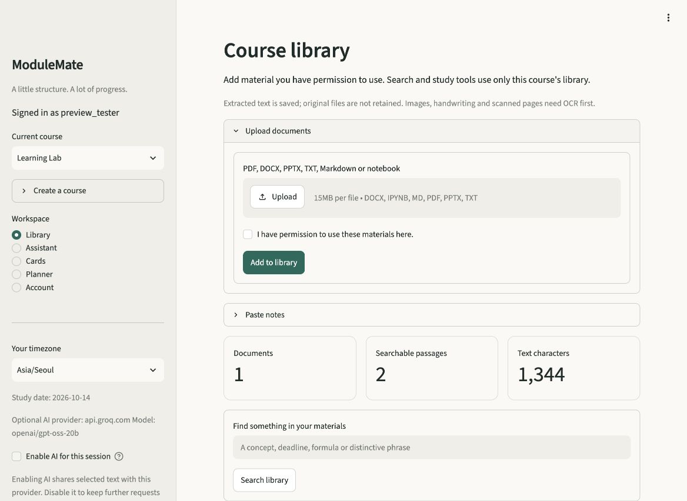

# ModuleMate

**Your materials. Your study space.**

ModuleMate is a local/self-hosted student assistant that turns your own notes into
searchable evidence, study cards and a practical revision plan. Every account
starts empty. No university slides, assignments, group chats or extracted course
text are bundled with this version.



## What you can do

- **Organize courses:** separate libraries, conversations, cards and deadlines.
- **Bring your materials:** PDF, DOCX, PPTX, TXT, Markdown, notebooks or pasted
  notes. Page/slide/section/cell references stay attached to searchable passages.
- **Ask with evidence:** local search works without an API key. Optional AI can
  explain, compare, summarize selected passages or guide you with a question.
  Its source IDs and verbatim evidence quotes are checked before display.
- **Practice recall:** write cards, draft local cloze cards or use optional AI
  drafts. Review before saving; reveal answers before grading; practice with a
  shuffled quiz. Due cards follow a simple spaced review schedule.
- **Plan study:** add tasks, dates and time estimates. Allocate daily capacity,
  see what does not fit and export deadlines to a calendar.
- **Control your data:** export your account, clear chats, remove documents,
  change your password or delete your account.

Materials are indexed for retrieval, **not used to train a model**. Upload only
content you have permission to use. This app does not determine your course's
rules or grant permission to redistribute someone else's material.

## Start in two commands

Requires Python **3.12 or 3.13** and [uv](https://docs.astral.sh/uv/).

```bash
uv sync --locked
uv run streamlit run app.py
```

Open the local URL printed by Streamlit, create an account, then create a course.
Upload your own material or click **Add original Learning Lab example**. The
example is a short, newly written fictional course, with no inherited material.
No model downloads, LibreOffice, OCR services or API keys are needed for local
search, manual/cloze cards, quizzes and planning.

For pip-based hosting, `requirements.txt` is exported from `uv.lock`:

```bash
python -m venv .venv
.venv/bin/python -m pip install -r requirements.txt
.venv/bin/python -m streamlit run app.py
```

Windows: use `.venv\Scripts\python` instead. The default address is `127.0.0.1`;
the app is not exposed to your network automatically.

## Optional AI

Copy `.env.example` to `.env` **only if you do not already have a `.env` file**.
Set `MODULEMATE_AI_BASE_URL`, `MODULEMATE_AI_MODEL` and `MODULEMATE_AI_API_KEY`
for an OpenAI-compatible chat-completions provider supporting JSON-object output.
Choose a model currently available from that provider; there is no hardcoded
model or automatic switch to a different provider. A compatible local server can
use a loopback HTTP URL and a placeholder API key if it requires none.

AI remains off until the signed-in user enables it in the sidebar. Requests send
the question, up to eight source excerpts and up to three recent conversation
turns. Card requests send excerpts. The provider's retention/training terms apply
to these requests; the app cannot control them. Keys are operator configuration,
never account-export data. An unavailable provider, malformed response or invalid
source reference falls back to clearly labeled local excerpts.

A second AI pass checks whether every claim is supported; failed checks fall back to excerpts. This adds one provider request per generated answer or card batch. Citation checks verify source IDs and quote membership with whitespace normalization. They do **not** prove
that the explanation follows from the quote or that the source itself is true.
Review the evidence. Summaries are sampled excerpts, not guaranteed full-document
coverage. Search is lexical, with Unicode normalization and CJK bigrams; semantic
paraphrases without shared words can be missed.

## Files, limits and privacy

Extracted text is persisted in `data/modulemate.sqlite3`; original uploads are
processed in memory and not saved to the library. `.gitignore` excludes runtime
data, environment secrets, old corpora and old indexes. Per-file processing is
limited to 15 MB, 2 million extracted characters, and 3,000 passages. See
[privacy and deployment](docs/PRIVACY_AND_DEPLOYMENT.md) for all limits and the
threat model. This is a small self-hosted app, not an audited public SaaS service.

Scans and diagrams need a searchable text layer or a pasted description. DOCX
sections are extraction units, not Word page numbers. Notebook code is never
executed; outputs are excluded. Parser warnings remain visible in the library.

## Development and checks

```bash
uv run pytest -q
uv run ruff check .
uv run ruff format --check .
uv run pip-audit --progress-spinner off
uv run python scripts/evaluate.py
uv run python scripts/benchmark.py
uv run python scripts/check_release.py
```

Tests cover actual file extraction, transaction rollback, concurrent first boot,
account isolation, FTS deletion, citation rejection, outage fallback, scheduling,
calendar encoding and a complete Streamlit study journey. They use original
synthetic fixtures and do not need network access. The audit command uses the
package advisory service. The evaluation is a small lexical regression set, not
a claim of general academic accuracy.

- [Detailed plan and acceptance criteria](PROJECT_PLAN.md)
- [Architecture](docs/ARCHITECTURE.md)
- [Privacy, configuration, deployment and backup](docs/PRIVACY_AND_DEPLOYMENT.md)
- [Migration from the fixed-corpus prototype](docs/MIGRATION.md)
- [Validation evidence and known limits](docs/VALIDATION.md)

## Repository history

The current source tree removes the previous fixed university corpus, OCR
extracts and course-specific evaluation outputs. **Earlier Git commits and
remote copies can still contain those files.** Removing files in a new commit
is not history erasure. Use a clean source export for a history-free distribution;
see [migration notes](docs/MIGRATION.md) before publishing the old repository's
history elsewhere.
