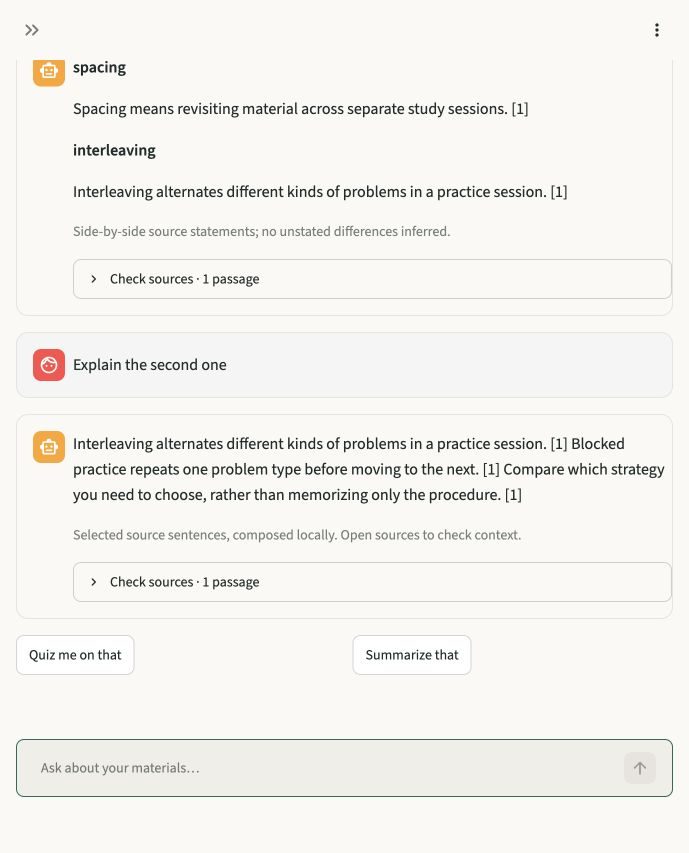

# ModuleMate

**A study chatbot grounded in your own materials.**

Ask a question, connect two ideas, or practice explaining a concept. ModuleMate
finds the relevant evidence and gives a concise, cited response. Local machine
learning handles paraphrases without an API key; optional generated explanations
can use an OpenAI-compatible provider or local model server.

Originally built for the **HIT Summer School 2026 AI and Machine Learning
project**, ModuleMate is now a private, user-owned study workspace. The summer
submission and the subsequent portfolio improvements are distinct;
[HIT project alignment](docs/HIT_PROJECT_ALIGNMENT.md) explains that history.
Every account starts empty. No university material is bundled.



## What it does

- **Understand your question:** hybrid word/semantic retrieval finds related
  wording, and a local relevance model helps rank the evidence.
- **Keep the conversation going:** ask “Explain the second one” after a comparison,
  follow a topic into recall practice and compare your explanation with its
  source, or switch to a new subject. Ambiguous
  references prompt a clarification.
- **Answer with sources:** a local extractive reader helps select the relevant
  sentence, with concise cited answers, comparisons, extractive
  study outlines and recall prompts work locally. The source panel shows the original passages for each citation. Unsupported details are identified rather than filled in.
- **Organize your learning:** separate courses; PDF, DOCX, PPTX, Markdown, text,
  notebook and pasted-note imports; source-linked flashcards, spaced reviews,
  practice quizzes, deadlines and daily study planning.
- **Keep control:** account isolation, document deletion, chat clearing, exports,
  password changes and account deletion. Hosted generation requires session consent.

Local answers select and arrange source sentences; they are **not free-form LLM
reasoning**. The models are pretrained, not trained on your documents. The small
intent classifier is trained on original example utterances shipped in this repo.

## Start with local machine learning

Requires Python **3.12 or 3.13** and [uv](https://docs.astral.sh/uv/).

```bash
uv sync --locked --extra ml
uv run --extra ml python scripts/prepare_models.py
uv run --extra ml streamlit run app.py
```

Model preparation downloads about **310 MiB** of pinned public encoder, relevance
and extractive-reader weights, once. Framework dependencies are additional. It does not upload documents. After setup, local inference works
offline on CPU. Keep `--extra ml` in `uv run` commands so uv retains the optional
model dependencies. No model download happens during a question.

Open the local URL, create an account and course, and add your materials or the
original **Learning Lab** example. New passages are indexed on the first question;
use **Library → Prepare local semantic search** to prepare a larger course first.
Existing vectors are reused and deleted with their source documents.

For a smaller installation without neural models:

```bash
uv sync --locked
uv run streamlit run app.py
```

This still provides the conversational extractive assistant, word matching,
summary/comparison/recall workflows, cards and planning. It can miss paraphrases.
The UI shows whether local semantic models are available. To repair a corrupt
model cache, rerun preparation with `--force`.

For pip deployments, install `requirements-ml.txt` for local ML or
`requirements.txt` for the smaller installation. Both are exported from `uv.lock`.
Then use `python scripts/prepare_models.py` (ML only) and
`python -m streamlit run app.py`. The default binding is `127.0.0.1`.

## Optional generated explanations

Copy `.env.example` to `.env` only if `.env` does not already exist. Configure
`MODULEMATE_AI_BASE_URL`, `MODULEMATE_AI_MODEL` and `MODULEMATE_AI_API_KEY` for a
chat-completions provider supporting JSON-object output. A compatible local
server can use a loopback HTTP URL and a placeholder key if none is required.
There is no automatic provider/model switch.

Generation remains off until the signed-in user enables it in the sidebar.
Requests send the question, up to eight source excerpts, a resolved follow-up
query and up to three recent conversation turns. Source filters also constrain
conversation context. Card requests send excerpts. The provider's data terms
apply; keys remain operator configuration, never account-export data.

Responses must include valid source IDs and exact supporting quotes. A second
request checks support. Invalid output, insufficient evidence or provider failure
falls back to a local response. These checks reduce mistakes; they do not prove
correctness, and the same model can repeat an error. Review the sources.

## Measured improvements

On an original **46-question development set** spanning 23 passages in seven
documents, first-result retrieval improved from **82.6% lexical to 91.3% hybrid**;
top-three retrieval improved from **93.5% to 100%**. Paraphrase first-result hits
improved from **66.7% to 85.7%** (21 questions). All eight unrelated questions
returned no evidence. Complete-answer reference-fact checks passed **45/46**
development questions and **18/20** additional challenge questions. These are
limited fact-coverage checks, not semantic correctness scores. The results are
small synthetic observations, not a
blinded evaluation or general accuracy claim.

At 100 synthetic documents / 3,700 passages, preparing the neural index and first
search took **67.72 seconds**; subsequent retrieval took **281 ms median / 316 ms
p95**, with 100/100 exact-topic hits. These timings exclude model loading,
answer composition and hosted generation. See [validation](docs/VALIDATION.md)
for failures, model comparisons, test commands and limitations.

## Development

```bash
uv run --extra ml pytest -q
MODULEMATE_TEST_LOCAL_ML=1 uv run --extra ml pytest tests/test_local_models.py -q
uv run --extra ml ruff check .
uv run --extra ml ruff format --check .
uv run --extra ml python scripts/evaluate_intelligence.py --local-ml
uv run --extra ml python scripts/evaluate_answers.py --local-ml
uv run --extra ml python scripts/evaluate_answers.py --local-ml --challenge
uv run --extra ml python scripts/benchmark.py --local-ml
uv run --extra ml pip-audit --progress-spinner off
uv run --extra ml python scripts/check_release.py
```

Ordinary tests require no network/model downloads. Real-weight tests are explicit.
CI runs the small installation on Python 3.12 and 3.13; manually dispatched CI
also installs and tests the neural models. CI results are separate from local checks.

## Limits and documentation

Scans and diagrams need a searchable text layer or a pasted description. Local
English models do not establish multilingual semantic quality; CJK word matching
remains available. Summaries sample selected passages, not an entire long course.
Extracted source text can itself be wrong or conflict with other text, and local
sentence selection does not resolve every ambiguity or prove entailment.

Extracted text, vectors and study data stay in `data/modulemate.sqlite3`; original
uploads are processed in memory. Limits include 15 MB per file and 12,000 passages
per course. This is a small local/self-hosted app, not an audited public SaaS service.

- [Intelligence improvement plan](docs/INTELLIGENCE_PLAN.md)
- [Architecture and model references](docs/ARCHITECTURE.md)
- [Privacy, deployment and backup](docs/PRIVACY_AND_DEPLOYMENT.md)
- [Migration](docs/MIGRATION.md)
- [HIT project alignment](docs/HIT_PROJECT_ALIGNMENT.md)
- [Validation and known limits](docs/VALIDATION.md)

The current source tree excludes the former university corpus and personal
runtime data. **Earlier Git commits and remote copies may still contain removed
files.** A new commit does not erase history. See the migration guide before
redistributing old history. Upload only material you have permission to use.
