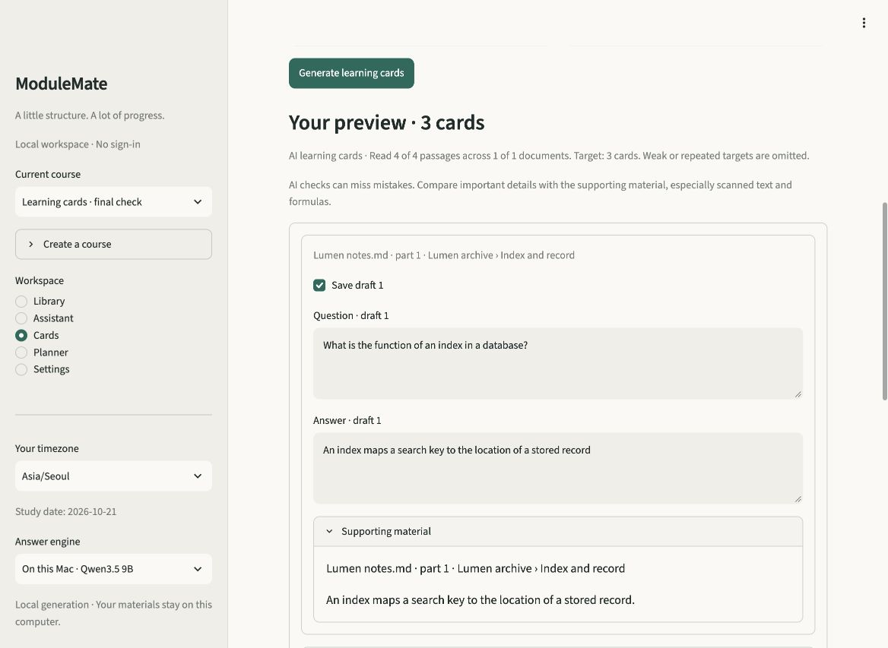

<p align="center">
  
</p>

# ModuleMate 2

**A local AI study workspace for your own materials.** Ask questions with inspectable sources, create learning cards, and turn important dates into editable calendar events.

[](https://github.com/MarlenMM/modulemate/actions/workflows/ci.yml)
[](pyproject.toml)
[](LICENSE)

[Quick start](#quick-start) · [Project overview](docs/PROJECT_OVERVIEW.md) · [Architecture](docs/ARCHITECTURE.md) · [Validation](#validation) · [Privacy](docs/PRIVACY_AND_DEPLOYMENT.md)

ModuleMate starts with an empty library. Add your notes, slides, documents or images, then work with them in one English-language workspace. Prepared local inference runs on your computer; the app requires no account or hosted service.

## From materials to study tools

| Workspace | What you can do |
|---|---|
| **Library** | Organize courses, import materials, recover printed image text with local OCR, and inspect located passages. |
| **Assistant** | Explain, summarize, compare and follow up. Inspect citations and get supported steps when a complete answer needs missing information. |
| **Cards** | Generate focused questions or clozes from selected materials. Edit and select drafts, inspect source excerpts, and practise with spaced review or quizzes. Manual creation remains available. |
| **Planner** | Extract events and deadlines, correct uncertain details, and save selected drafts. Edit your events and export them to a calendar. Study tasks also support daily capacity planning. |

### Planner: review first, then export

Select materials in **Planner → Extract from materials** and click **Extract dates**. Each draft keeps its supporting excerpt. Missing years, ambiguous clocks/timezones, tentative notices and conflicting dates remain unchecked for correction.

Edit the wording and event details, remove unwanted drafts, and save the selection. In **Events and dates**, download selected events as an `.ics` file for Google Calendar, Apple Calendar or another iCalendar client. Eligible single events also offer a Google Calendar link.


*Actual application screenshot using original fictional material. Calendar files are snapshots; importing a file does not establish ongoing synchronization.*

<details>
<summary><strong>Cards: editable generation with supporting material</strong></summary>

Open **Cards → Create cards → Generate from materials**. Choose documents, an optional topic, 1–24 cards and a style: Mixed recall, Question and answer, or Fill in the blank. Review, edit or exclude drafts before saving. Reveal answers and supporting excerpts during practice.



AI writes the questions; application code binds answers to literal source spans and constructs clozes. Individual review and an independent source-bound QA reader can request targeted repairs. Sparse material can produce fewer cards. **Write your own** and offline **Source cloze** remain available.

[Design decisions](docs/CARDS_DEVELOPMENT.md) · [Inspected output and browser checks](docs/VALIDATION_V25.md)

</details>

<details>
<summary><strong>Assistant: local answers with inspectable evidence</strong></summary>

Ask a focused question, explain a concept, compare notes, or continue with a follow-up. Broader questions can connect several passages; sampled selections show actual coverage. Independent questions use current material without copying previous assistant claims.


The example returns the source's “42 degrees” without inventing a missing temperature scale. Conceptual synthesis, supported partial help, bounded numerical tools and literal source inspection share the same course/document boundaries.

[Material-understanding decisions](docs/INTELLIGENCE_V24.md) · [Actual answers and limitations](docs/VALIDATION_V24.md)

</details>

## Quick start

The prepared conversational runtime uses **Apple Silicon**, **Python 3.12 or 3.13**, and [uv](https://docs.astral.sh/uv/).

```sh
git clone https://github.com/MarlenMM/modulemate.git
cd modulemate
uv sync --locked --extra ml --extra local
uv run --locked --extra ml --extra local python scripts/prepare_models.py
uv run --locked --extra ml --extra local python scripts/prepare_chat_model.py
uv run --locked --extra ml --extra local streamlit run app.py
```

Open **http://127.0.0.1:8501**, create a course, and upload material or add the original Learning Lab example.

Model preparation explicitly downloads pinned public weights into your local cache. The default 9B generator uses about 5.5 GiB of downloaded weights. Once prepared, local inference works offline and study material is not uploaded. Keep both extras in local `uv run` commands so uv preserves the installed runtimes.

The documented uv setup includes a tested Pillow security override for Streamlit's upstream dependency constraint. See the [compatibility record](docs/VALIDATION_V25.md#automated-and-storage-checks).

<details>
<summary><strong>Other computers and optional providers</strong></summary>

The library, manual cards, review, tasks and calendar tools also run with:

```sh
uv sync --locked
uv run --locked streamlit run app.py
```

Without a prepared conversational model, the Assistant clearly displays **Excerpt mode**. AI card/event generation requires a generator; manual workflows, source clozes and an explicitly unreviewed date scan remain available.

A compatible local server can be configured through [.env.example](.env.example), for example an installed Ollama model at `http://127.0.0.1:11434/v1`. Hosted providers require HTTPS, a model and a key. Select and explicitly enable the configured provider in the sidebar; it receives selected context and relevant review payloads. Local failure does not silently activate a hosted provider.

A smaller 4B local candidate can be selected using `MODULEMATE_CHAT_VARIANT=4b` during preparation and application startup. Its smaller size is not a claim of equivalent quality. See the [local-model validation](docs/VALIDATION_V22.md).

</details>

## Supported materials

| Input | Reading support |
|---|---|
| **PDF and images** | Native PDF text, scanned/mixed pages, outlined PDF letters, PNG, JPEG and WebP. Local OCR retains locations and reading notices. |
| **Word and PowerPoint** | Body text, tables, notes, referenced Word document parts, embedded pictures, cached chart values and SmartArt labels. |
| **Notes and notebooks** | TXT, Markdown, pasted notes and static IPYNB code/text/saved image outputs. Notebook code is never executed or recomputed. |

Uploads are limited to **15 MB per file**. macOS OCR uses Apple Vision. Linux/Windows require an installed [Tesseract engine with English data](https://tesseract-ocr.github.io/tessdoc/Installation.html); Ubuntu packages are `tesseract-ocr` and `tesseract-ocr-eng`.

OCR is bounded and can misread names, numbers, formulas or layout. Chart/diagram relationships and handwriting may need a description; saved outputs can be stale. Original files are discarded after extraction, so older imports may require reimporting the original to recover newly supported content.

## AI and engineering

The system combines a pretrained local generator with original supervised evidence components and application-owned source binding.

| Component | Implementation |
|---|---|
| **Language generation** | Pinned Qwen3.5 9B, quantized for local MLX inference. |
| **Retrieval** | SQLite FTS5, persistent MiniLM embeddings, hybrid rank fusion, optional reranking and a source-bound extractive reader. |
| **Original ML** | Relevance, answerability and pairwise-ranking logistic heads fitted on original labeled material with separate training/calibration/test documents. |
| **Evidence contracts** | Course/document scope, validated source IDs and literal spans; advisory estimates can request one bounded deeper look. |
| **Study outputs** | App-owned card answer/cloze construction and temporal normalization, editable drafts, atomic saves and durable supporting excerpts. |
| **Persistence and export** | SQLite migrations/backups, spaced scheduling, and iCalendar export with timezone/recurrence handling. |

The evidence dataset contains **22 original documents, 88 passages, 154 questions and 1,386 candidate/bundle examples**. The generator, encoder, reranker and reader use pretrained weights; no foundation model is trained on learner materials. Local feedback is available for human review and never automatically retrains the system.

Read the [project overview](docs/PROJECT_OVERVIEW.md), [evidence model/data card](docs/EVIDENCE_MODEL_CARD.md) and [architecture](docs/ARCHITECTURE.md) for the development history, fitted models, rejected approaches and implementation boundaries.

## Validation

| Evidence | Recorded result |
|---|---|
| **Full local regression suite** | 480 passing tests with real local-weight checks, OCR and a 65-page scan stress case enabled. |
| **Learning-card inspection** | 22 case/style runs, 88 retained cards read against their excerpts, with exact answer/source membership and isolated saves. |
| **Planner inspection** | 32 cases, 53 ready events and 17 held drafts. Specified ready-event fields matched; exports round-tripped through iCalendar. |
| **Application acceptance** | Actual browser generation/edit/select/save/review flows and parsed calendar downloads, plus automated Streamlit journeys. |
| **Reproducibility** | Original fictional fixtures, actual model-call/output records, pinned weights and implementation/fixture identities. |

These are authored development cases, not a blind real-world accuracy estimate. Matching source text or an approving model review does not prove an inference correct. The Planner's final matrix had no extra or mismatched ready events; this does not establish zero false positives on arbitrary material.

To repeat the main checks after model setup:

```sh
uv run --locked --extra ml --extra local ruff check .
uv run --locked --extra ml --extra local ruff format --check .
MODULEMATE_TEST_LOCAL_ML=1 MODULEMATE_TEST_OCR=1 MODULEMATE_TEST_OCR_STRESS=1 \
  uv run --locked --extra ml --extra local pytest -q
uv run --locked --extra ml --extra local pip-audit
uv run --locked --extra ml --extra local python scripts/check_release.py
```

[Conversation validation](docs/VALIDATION_V22.md) · [Evidence experiments](docs/VALIDATION_V23.md) · [Material understanding](docs/VALIDATION_V24.md) · [Cards](docs/VALIDATION_V25.md) · [Planner and calendars](docs/VALIDATION_V26.md) · [Evaluation guide](evaluation/README.md)

## Data and privacy

One local workspace replaces sign-in. SQLite stores extracted text and study records with private file permissions; ModuleMate does not encrypt the database. No university corpus, personal submissions, runtime database, credentials or neural weights are bundled in this repository.

Local OCR and prepared inference stay on the machine. Explicitly enabled providers receive selected context. Deleting supporting material removes locally derived records, while external calendar imports and previous backups remain separate copies. Source excerpts are optional and off by default in calendar exports.

[Local data and provider boundaries](docs/PRIVACY_AND_DEPLOYMENT.md) · [Migration and backups](docs/MIGRATION.md)

## Origin and license

ModuleMate began as the **HIT Summer School 2026 Artificial Intelligence and Machine Learning Smart Chatbot project**, then developed into this general material-based study workspace. The [project alignment](docs/HIT_PROJECT_ALIGNMENT.md) distinguishes the original brief, later engineering and trained versus integrated models.

The application is [MIT licensed](LICENSE). Original evaluation material is identified in the [evaluation guide](evaluation/README.md); pretrained models retain their respective licenses.

Built with [Streamlit](https://streamlit.io/), [MLX LM](https://github.com/ml-explore/mlx-lm), [Qwen](https://huggingface.co/Qwen/Qwen3.5-9B), [Sentence Transformers](https://www.sbert.net/) and [icalendar](https://icalendar.readthedocs.io/).
