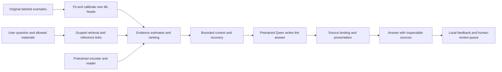

# ModuleMate evidence learning

This is an applied ML contribution around a pretrained conversational model.
The generator, encoder and extractive reader use pretrained public weights.
ModuleMate trains its own relevance, answerability and pairwise ranking heads
on original annotated examples. It does not claim a new foundation model or a
new research algorithm.

## Tasks and architecture

Thirty numerical features describe question/source overlap, sentence coverage,
document-title coverage, requested answer shape, absence/condition cues, semantic
similarity and extractive-reader signals. The latter include a validated source
span's presence, answer-versus-null logit margin and relative length. Neither a
cosine similarity nor a reader margin is treated as a probability.

Three L2-regularized logistic heads are fitted with `C=0.3`, balanced class weights,
standardized inputs and seed 2026:

- Relevance predicts whether the annotation marks any requested information in a
  passage, including partial support.
- Answerability predicts whether that candidate supplies the complete annotated
  answer. A merely relevant passage is a negative for this task.
- Ranking learns from differences between candidates for the same question, with
  both signs of every unequal-grade pair. Grades distinguish unrelated, partial
  and complete evidence. The ranking logit is not a confidence percentage.

Separate Platt calibrators (`C=1`) use calibration documents only. Scaling is baked
into the exported coefficients; runtime inference uses JSON numerical weights,
not pickle/joblib. Lexical, encoder and encoder-plus-reader variants allow direct
ablations. Feature schema/version, pretrained revisions, dataset hash, fit and
calibration document IDs accompany each artifact.

## Data and splits

`evaluation/evidence_learning.json` contains 22 original fictional documents,
88 passages and 154 questions across subjects. Each document has four passages
and seven questions. Sources, paraphrases, compound questions and derived negatives
remain in one document partition. Cross-document negatives use a peer in the
same partition, never a test passage in training.

| Partition | Documents | Questions | Candidate/bundle rows |
|---|---:|---:|---:|
| Training | 12 | 84 | 756 |
| Calibration | 5 | 35 | 315 |
| Test | 5 | 35 | 315 |

The training ranking head uses 1,376 signed pair differences. Every question also
has a whole-document evidence bundle. Compound answers require all listed gold
passages. A related passage or an explicit statement that a requested fact is
unstated does not count as a complete substantive answer. These labels concern
evidence availability, not whether saying 'not stated' is a helpful response.

The data are CC0 original examples. No university documents, personal uploads,
chat logs, or runtime feedback are fitted. They are deliberately small and
synthetic. The test partition is a fixed diagnostic, not a representative or
blinded estimate of real-world accuracy. Calibration-set measurements reflect
development and fitting of the calibration mapping.

## Runtime use

The generative path assesses both individual passages and, within a bounded
size, their combined context. This matters when facts or cross-references span
several passages. Scores may trigger one deeper retrieval pass while preserving
the user's course/document filters. A replacement must improve an estimated weak
part without substantially reducing another part's estimate. The classifier never
forces a refusal or authorizes a new source.

Combining maxima over candidates or assessing a longer context changes the
distribution. The resulting runtime estimates are advisory; they are not calibrated
probabilities that the final answer is correct. Source-span identities and bounds
are checked before reader output is used. Missing models/artifacts retain the
lexical/semantic paths, without downloads during a question.

Complete short selections are read together before keyword narrowing. Baseline,
full-document and adaptive context policies remain selectable in the evaluation
runner. The optional learned ranking vote is separately measurable; its benefit
must not be inferred from answerability metrics or one small benchmark.

## Experiments and known limits

The first encoder-only calibration run produced answerability average precision
0.8598 and Brier score 0.0472. Adding reader signals produced 0.9464 and 0.0289 on
that same development partition. These are evidence classification measurements,
not chatbot correctness. The evaluation reports all errors, prevalence, a constant
base-rate Brier reference, calibration bins and selective error/coverage.

On the calibration ranking candidates, plain dense retrieval still beat the
learned ranker (24/25 versus 23/25 first relevant hits). A 0.25 learned vote improved
the tested lexical/dense rank fusion from 20/25 to 23/25, without losing complete
gold coverage at three. The earlier 46-question retrieval diagnostic exposed a
tradeoff: the same vote moved one correct first hit to second and one third hit
to second, retaining all 46 hits at three. These do not establish universal gains.

An independent optional NLI classifier was also evaluated. It detected actual
unsupported source expansions but produced many false flags on valid paragraph
answers. It remains an explicitly enabled experiment, disabled by default, and
does not automatically reject or repair production answers. Its public pretrained
weights are integrated, not trained by ModuleMate. See the validation log for
actual experiments and later test observations.

## Reproduce

```sh
uv run python scripts/train_evidence.py
uv run python scripts/evaluate_evidence.py --split test
uv run --extra ml --extra local python scripts/train_evidence.py --reader
uv run --extra ml --extra local python scripts/evaluate_evidence.py --reader --split test
uv run --extra ml --extra local python scripts/evaluate_conversations.py --policy baseline
uv run --extra ml --extra local python scripts/evaluate_conversations.py --policy full
uv run --extra ml --extra local python scripts/evaluate_conversations.py --policy adaptive
```

The neural commands require the explicitly prepared local models. Final held-out
results and release checks are recorded separately in the validation report.

## Component boundaries



Feedback does not feed training automatically. Evidence estimates are not final
answer correctness probabilities. Possible omitted-citation excerpts are review
hints; the failed automatic relabeling experiment is not enabled in production.

## Research references

- [Selective Question Answering under Domain Shift](https://aclanthology.org/2020.acl-main.503/): learned calibration and abstention; our estimates are used for bounded evidence recovery instead of hard refusals.
- [Retrieval-Augmented Generation](https://arxiv.org/abs/2005.11401): pretrained generation combined with external evidence.
- [Independent NLI model card](https://huggingface.co/cross-encoder/nli-deberta-v3-small): model provenance, training sources and label order; its benchmark scores do not apply to this application.
