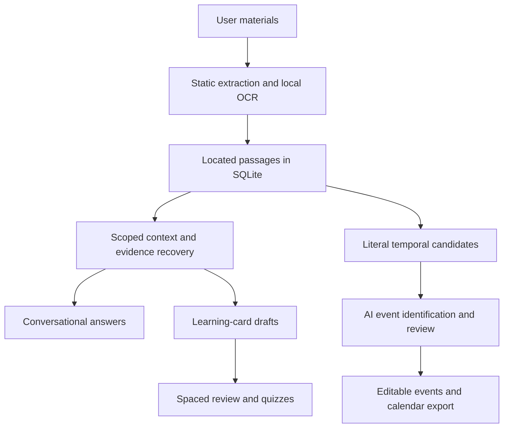

# ModuleMate 2 — project overview

[Home](../README.md) · [Architecture](ARCHITECTURE.md) · [Evaluation](../evaluation/README.md) · [Privacy](PRIVACY_AND_DEPLOYMENT.md)

ModuleMate 2 is a local study workspace built around materials supplied by its user. It combines a source-grounded conversational assistant, generated learning cards, spaced practice, date/event extraction and portable calendar export.

The project began as the HIT Summer School 2026 AI/ML Smart Chatbot assignment. Subsequent development replaced the fixed course corpus with a general personal library and added the current workflows. This overview summarizes the complete development; the linked records retain implementation decisions, actual outputs, failures and qualifications.

## Product and scope

A new workspace starts empty. A learner creates a course, imports material or pastes notes, then uses the Library, Assistant, Cards and Planner. The English interface runs locally without an account. An original fictional Learning Lab example is available for exploration.

The principal design choices are:

- **User-owned material:** course/document selection constrains retrieval and generated outputs.
- **Inspectable evidence:** answers, generated cards and extracted events retain actual located passages.
- **Useful assistance:** explanations can connect several passages, and missing final inputs need not prevent supported preliminary help.
- **Editable outputs:** a learner reviews generated cards/events before saving and can change or discard them.
- **Local ownership:** explicit model preparation, SQLite persistence, migration backups and deliberate exports.

Local generation uses prepared pretrained weights. A separately configured provider requires explicit activation; a local failure does not silently send material elsewhere. Public multi-user hosting is outside the current design.

## Development history

| Stage | Work completed | Reason for the change |
|---|---|---|
| **Original chatbot** | Ingestion, indexing, retrieval, intent routing, evidence generation, refusal handling, evaluation and a conversational interface. Later hybrid retrieval/reranking, reliability checks and release/UI improvements. | Make course information searchable and answers traceable. |
| **Personal study workspace** | Removed the bundled corpus; added courses, own-material uploads, located passages, SQLite/FTS5, source inspection, cards/review/quizzes, tasks, capacity planning, export and deletion. | Make the product useful across subjects and keep private coursework outside the release. |
| **Local neural retrieval** | Pinned semantic encoder, reranker and extractive reader; persistent vectors, hybrid fusion, identifier handling, offline checks and alternative-model comparisons. | Recover paraphrases that word matching missed without losing exact identifiers. |
| **Conversational rebuild** | Local Qwen explanations, question-aware context, genuine follow-ups, ordered lessons, numerical tools and separate prose/evidence passes. Removed the account flow. | Sentence retrieval and fact-phrase scores did not demonstrate a useful tutor. |
| **Original evidence ML** | New labeled data, relevance/answerability/ranking heads, calibration and ablations; adaptive evidence recovery, bounded uploaded-file references and local feedback review. | Improve evidence selection while keeping learned scores advisory. |
| **Material understanding** | Local OCR and deeper Office/notebook extraction; broad conceptual context, honest long-material coverage, source/notation repairs and history isolation. | Some failures began before generation: unread images, omitted endings, missed conditions or stale assistant claims. |
| **Learning-card generation** | Focused source-span answers, literal clozes, individual review, reader-assisted repair, coverage/duplicate controls and atomic selected saving. | Whole-excerpt answers were unfocused, and freely written answers changed qualifications. |
| **Planner extraction** | AI event identification with literal temporal candidates; uncertainty review, durable editable events, explicit replacement, continuation and iCalendar output. | Generated timestamps and dense writer batches were insufficiently reliable. |

An account-based design existed in the workspace foundation. Its migration preserved study record identities and removed authentication from the active schema. Historical validation files can describe that earlier design; the current app has one shared local workspace.

[Original requirements and contribution](HIT_PROJECT_ALIGNMENT.md) · [Historical delivery plan](../PROJECT_PLAN.md) · [Migration history](MIGRATION.md)

## Material reading

Supported inputs include PDF, DOCX, PPTX, TXT, Markdown, IPYNB, PNG, JPEG, WebP and pasted notes. Extraction preserves document names and page/slide/section/image/cell locators.

We extended reading beyond ordinary body paragraphs to referenced Word headers/footers/notes/text boxes, PowerPoint chart caches/SmartArt labels and static saved notebook text/raster outputs. Notebook code, macros, workbooks and external relationships are not executed or fetched. Saved values can therefore be stale.

Local OCR uses Apple Vision on macOS or an installed Tesseract engine elsewhere. It handles scans, mixed PDFs, outlined PDF letters and embedded/uploaded pictures. Native text survives OCR failure, and notices identify unread or uncertain locations. A synthetic 65-page scanned-PDF stress case recovered all 65 locations, including the final page.

Recognition and parsing are bounded for responsiveness. Original uploads are discarded after extraction; older imports can require the original to be reimported. OCR confidence concerns recognition, not source credibility. Mathematical layout and diagram geometry remain limited.

## Conversations and evidence

The Assistant supports facts, explanations, summaries, comparisons, ordered teaching, learner attempts, follow-ups, supplied-text/code transformations and supported methods. Bounded numeric routines compute explicitly supplied data without executing uploaded code.

Retrieval assembles question parts, adjacent passages, both sides of comparisons and structural context for broad questions. Short selections can be read completely; longer selections sample their beginning, middle and end and report the real passage coverage. An uploaded-file reference graph adds at most two allowed targets over one hop.

One bounded deeper search can recover missing evidence. A learned answerability score cannot authorize an unselected file or forbid a broader look after an insufficient answer. Ambiguous document references receive clarification.

The writer produces Markdown separately from constrained evidence labeling. The application owns source IDs and literal span binding. Short source bodies remain valid evidence. A citation-attachment failure is distinguished from a missing factual answer, and a narrow quotation repair does not erase ordinary conceptual synthesis.

Actual failures led to important distinctions: an ordinary method question is not automatically a request for permission; an unnamed sponsor is not proof that none existed; missing final inputs need not prohibit preliminary work; and checking a process is not a guarantee of its outcome.

Independent material questions exclude previous assistant prose from writer input. Genuine follow-ups retain bounded relevant history. Saved conversations remain intact, and document selection persists across course/tool navigation.

[Rebuild and 18-cycle record](INTELLIGENCE_REBUILD.md) · [Material-understanding decisions and 20-cycle record](INTELLIGENCE_V24.md)

## Original machine learning

The pretrained generator provides broad language capability. Our own supervised components are an earlier four-label intent experiment and later evidence models.

The intent experiment uses 120 original synthetic utterances with TF-IDF/logistic regression. The evidence dataset contains 22 fictional documents, 88 passages and 154 questions, producing 1,386 candidate/bundle examples:

| Partition | Documents | Questions | Candidate/bundle examples |
|---|---:|---:|---:|
| Training | 12 | 84 | 756 |
| Calibration | 5 | 35 | 315 |
| Test | 5 | 35 | 315 |

Document families, paraphrases, derived negatives and whole-document bundles stay inside their own partition. The material is original CC0 content; private coursework, uploads, conversations and runtime feedback are not fitted.

Three L2-regularized logistic heads estimate relevance, complete answerability and pairwise evidence ranking. They use 30 features with lexical, semantic and semantic-plus-reader ablations. Pairwise fitting uses 1,376 signed differences. Calibration is separate, and inspectable JSON weights incorporate feature standardization.

Frozen test answerability average precision was 0.9028 for lexical features, 0.8962 for semantic features and 0.9100 with reader features. These measure evidence classification, not correct chatbot answers. The reader variant still had 18 classification errors at the tested threshold, including confident false positives. Ranking comparisons also exposed mixed gains on different fixtures.

Learned scores remain advisory. Local answer ratings/corrections prepare a human-review queue and do not automatically become training labels.

[Model/data card and reproduction](EVIDENCE_MODEL_CARD.md) · [Evidence development and 11-cycle record](ML_DEVELOPMENT.md) · [Measurements and limits](VALIDATION_V23.md)

## Learning cards

The learner selects documents, an optional topic, 1–24 target cards and Mixed recall, Question and answer, or Fill in the blank. AI chooses learning targets and writes questions; application code binds answers to offered literal source spans and constructs clozes from the actual sentence.

Individual review examines premise, conditions and attribution. A prepared extractive QA reader can request a targeted repair for strong, offset-validated disagreement; weak/no-answer output never vetoes a card. Repairs can rebind a wrong answer while preserving a useful question.

Coverage samples material positions and can repair a missed section. Duplicate checks preserve different subjects, values, units, inequalities, modality and table targets. Clear two-column tables and short labeled facts have dedicated construction paths. Fewer useful cards are preferred to padding a requested count.

Editable/selectable previews retain supporting excerpts. Transactional saving rechecks every source; editing preserves evidence and marks the card as edited. Deleting any supporting document removes the derived card/reviews. Backed-up migrations preserve old card IDs, schedules and history.

Manual creation and offline Source cloze remain available. Spaced review hides answers/evidence until reveal; practice quizzes do not change the review schedule.

The final output matrix covered 22 case/style runs and 88 retained cards. All were read against their excerpts, passed literal membership and saved in isolated storage. Cases included code, formulas, conditions, thresholds, conflicts, literary interpretation, boilerplate and long repeated material. The long case retained ten distinct cards from a target of twelve rather than adding duplicates.

[Approaches, failures and repairs](CARDS_DEVELOPMENT.md) · [Validation and real browser checks](VALIDATION_V25.md)

## Planner and calendars

The learner selects materials and extracts dates into editable/selectable drafts. The hybrid design combines literal source date/time/duration candidates with AI identification of actionable events and per-event source review. Explicit source information takes precedence; today's year and an event duration are not silently assumed.

Missing years, numeric-order ambiguity, unclear clocks/zones, tentative notices, unanchored relative dates, conflicts and unsupported recurrence remain unchecked for correction. Source headings distinguish real schedules from examples. A separate date scan provides unreviewed mentions when no generator is available.

Recognized calendar tables use labeled columns directly and retain AI source/relevance review. Overlapping partial rows are reconciled only within matching document/heading context. Larger selections review up to 180 date-bearing sections per request and continue after saving/discarding the current preview.

Saved events support editing, removal, filtering, selective export, duplicate avoidance and explicit replacement that retains calendar identity. Source validation is transactional. Existing study tasks retain their estimates, due dates, completion and daily capacity scheduling.

The portable `.ics` export uses a maintained iCalendar library, stable UIDs, incremented revision sequences, exclusive all-day end dates, unambiguous timed instants and bounded weekly timezone-aware recurrence with exceptions. A deadline without an end remains a point. Eligible one-off events also provide Google Calendar template links.

The final authored matrix covered 32 cases: 53 ready events matched specified fields and 17 uncertain drafts were held. No extra/mismatched ready events or missing expected events occurred in that matrix. All ready events saved and round-tripped through iCalendar. This does not establish zero false positives on arbitrary material.

The dense-table experiment changed the implementation: an initial writer request failed; row batches recovered 24/26 events in 196.13 seconds; explicit columns plus five AI reviews recovered all 26 in 73.62 seconds. These are local observations, not controlled speed guarantees.

Actual browser tests inspected generated evidence, edited/excluded/saved drafts and parsed downloaded files. Saved edits preserved UIDs and incremented SEQUENCE; re-extraction preserved edited wording. Independent recurrence expansion kept nine 10:00 local occurrences across a New York DST transition with an exception.

Calendar files are snapshots. External calendar accounts were not modified during tests, and live client import/synchronization is not claimed. Client prompts and repeated-import behavior remain client-controlled.

[Design and 10-cycle comparison](PLANNER_DEVELOPMENT.md) · [Validation, field results and actual downloads](VALIDATION_V26.md)

## Architecture and pretrained components

| Component | Implementation |
|---|---|
| UI | Streamlit, with course/tool scope and editable drafts. |
| Storage | SQLite, FTS5, migrations, backups, local vectors and dependent-data cleanup. |
| Generator | Pinned `mlx-community/Qwen3.5-9B-4bit`, with a smaller optional candidate. |
| Encoder | Pinned `sentence-transformers/all-MiniLM-L6-v2`. |
| Reranker | Pinned `cross-encoder/ms-marco-MiniLM-L-6-v2`. |
| Extractive reader | Pinned `deepset/minilm-uncased-squad2`. |
| Original trained components | Intent experiment and evidence relevance/answerability/ranking heads. |
| Calendar output | iCalendar serialization, timezone-aware bounded recurrence and encoded single-event links. |

Weights are explicitly prepared outside Git. The current generator/encoder were not fine-tuned on student material. The later Cards/Planner work required no hosted inference, Kaggle job or new training. Exact revisions and contracts are in the [architecture](ARCHITECTURE.md) and implementation.

## Evaluation and engineering evidence

Historical regression checkpoints progressed from 62 foundation tests to 88 initial local-neural checks, 174 offline conversational tests, 243 offline evidence tests, 340 combined material-reading tests, 406 Cards tests and 480 combined Planner-era tests. Real-model checks were separate at some early checkpoints; these totals must not be added together.

The latest full local run includes real neural-weight checks, native OCR and the 65-page stress fixture. Validation also uses original multi-subject/adversarial material, Streamlit AppTests, rendered-browser flows, exact source inspection, actual downloaded files, independent recurrence expansion and existing-database preservation checks.

The publication check on **22 October 2026** repeated the full local suite: **480 passed**, with one upstream Torch deprecation warning, in 28.68 seconds. Ruff lint/format and the locked-environment dependency audit also passed. These local results are separate from the repository's linked CI status.

The first publication CI run passed both Python jobs but exposed a Linux OCR fixture issue: Tesseract read a hand-authored 5×7 `N` as `M`. The path-only PDF fixture now uses ordinary bundled-font glyphs while retaining the exact `OPEN AT 42` assertion and checks that the PDF has neither native text nor image objects. This is a fixture portability repair, not a claim that arbitrary stylized OCR became more accurate; recognition uncertainty remains visible. The [original run](https://github.com/MarlenMM/modulemate/actions/runs/39654698217) preserves the failure, and [current CI](https://github.com/MarlenMM/modulemate/actions/workflows/ci.yml) reports subsequent checks.

Recorded output archives include 34 material-understanding runs/209 fixture turns, 25 card-generation checkpoints plus a reader diagnostic, and 11 Planner baseline/cycle reports. Final, superseded and incomplete runs keep their own implementation identities; a historical filename containing “final” does not override its status.

We rejected broad NLI vetoes, additional planning calls, long-thinking configurations, automatic citation-gap relabeling, free card-answer writing and free timestamp JSON when actual outputs showed false flags, invented prerequisites, incompletion, altered conditions or mismatched dates. Green phrase checks were not treated as proof of correctness.

Ruff, locked dependencies, advisory auditing, current-tree private-artifact checks and Linux/Python CI complement the behavioral tests. Security audit results are time-specific, and the release-tree guard does not scan or erase all history. See [validation](VALIDATION_V26.md), the [evaluation guide](../evaluation/README.md) and [GitHub Actions](https://github.com/MarlenMM/modulemate/actions).

## Data ownership and practical limits

The local database contains extracted material and study records with private file permissions, not application-level encryption. Backups precede migrations; exports/backups remain separate copies. Document deletion removes locally derived cards/events and clears source-derived course conversation. Original uploads are discarded after import.

Model generation, critique and QA reading can all be wrong. Exact membership establishes provenance, not entailment. OCR, equation layout, arbitrary diagrams, very dense prose and implicit scheduling logic remain limited. Long context/recovery is bounded. Old imports can require reimport, and static saved outputs may be stale.

The authored fixtures informed implementation and are not a blind representative accuracy test or evidence of measured educational benefit. Fresh transfer cases, output inspection and platform checks remain valuable maintenance work.

[Privacy and deployment](PRIVACY_AND_DEPLOYMENT.md) · [Migration and backups](MIGRATION.md) · [MIT license](../LICENSE)
