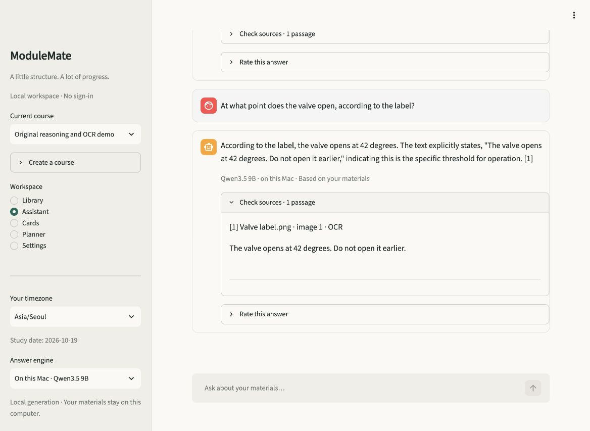
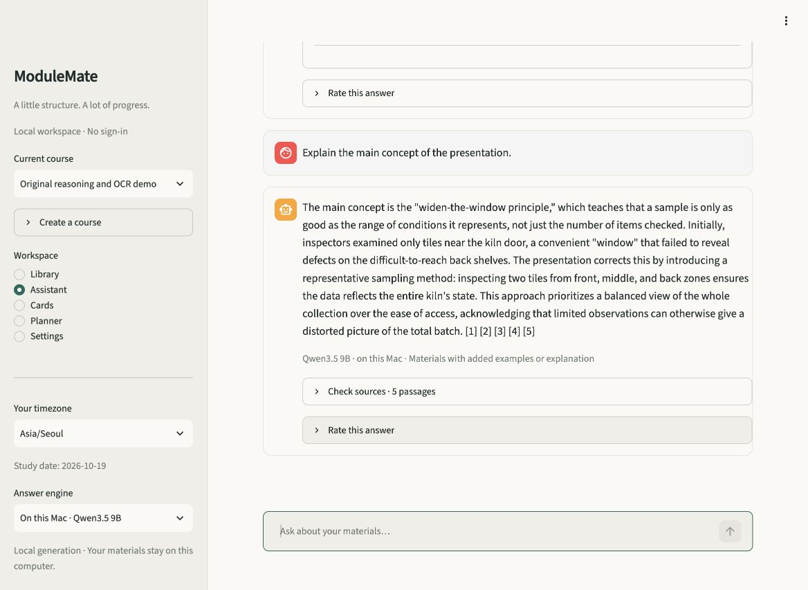
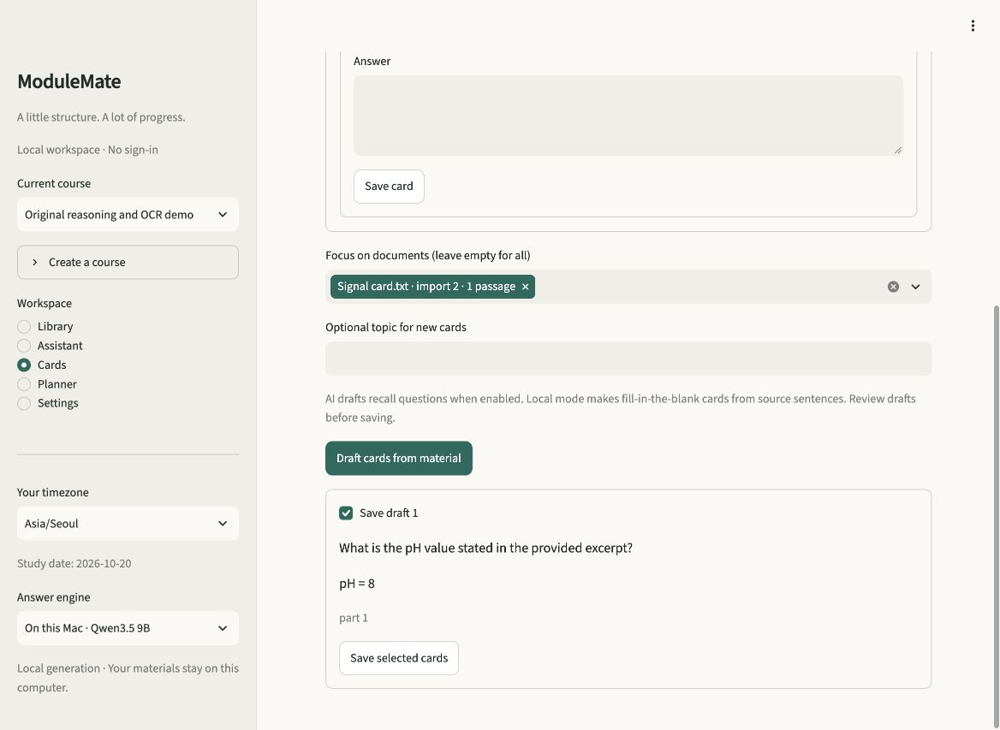
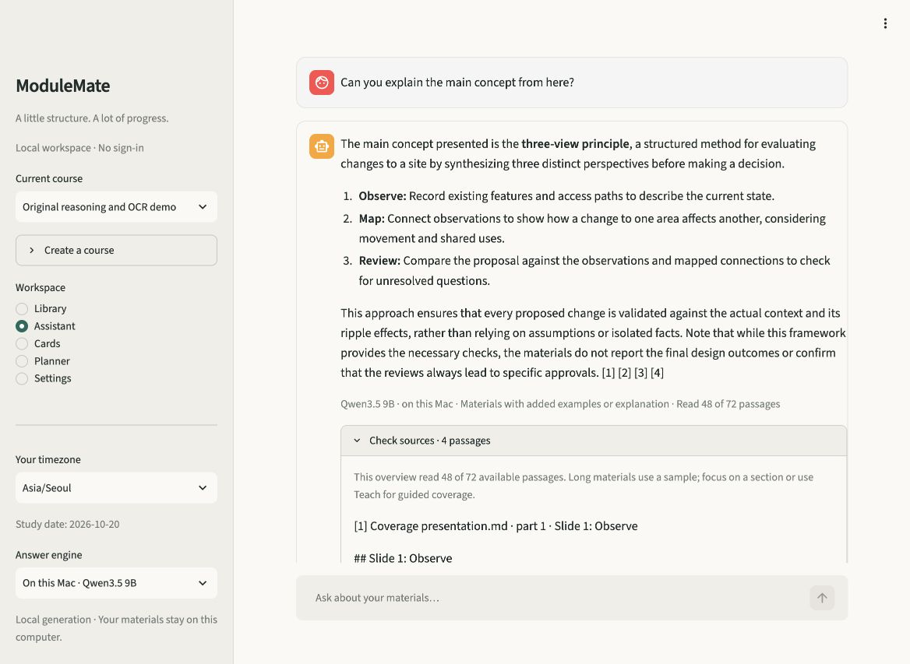

# ModuleMate 2.4 material understanding validation

Work performed on 19–20 October 2026 on an Apple M4 Pro with 24 GiB memory, using
the cached local Qwen3.5 9B 4-bit model. All public examples, observations and
screenshots contain original fictional material. One previously failed real request
was replayed locally in an ephemeral copy of its selected document; its source
text and answer are excluded from public artifacts. The learner's library and
history were unchanged. No hosted inference, external GPU or language-model
fine-tuning was used. The learned evidence artifacts and their frozen document
partitions were not refitted.

## What changed and why

The [decision and cycle log](INTELLIGENCE_V24.md) separates extraction, context,
generation and citation failures. Source provenance is retained. A small relevance
score, an extractive answerability estimate, incidental vocabulary or an inferred
word limit cannot establish that an explanation is unsupported. Main ideas,
interpretations and reasoned connections can be based on several passages rather
than an identical source sentence. Unknown facts still need to remain unknown.

Observed bugs repaired include a 12-character citation minimum losing `pH = 7`,
the first 48 passages silently excluding the end of a short 72-section deck,
missing native Office/diagram/chart/notebook text, and PDFs with outlined letters
but no native text or image objects. Old imports need the original reimported;
extracted-only storage cannot reconstruct discarded images. Changed imports are
separate copies with visible import numbers, preserving existing study data.

## Extraction and app verification

- Actual offline isolated OCR recovered the original image, scanned PDF, mixed
  native/image PDF and vector-letter PDF. Native text survives missing/failed OCR.
  Low recognition confidence retains the text with a notice. Recognition bounds
  and unread locations are visible rather than silently treated as absent facts.
- An original 65-page scanned PDF recovered all 65 locations and its final page;
  the retained timing was 6.36 seconds on this Mac. This is one synthetic document,
  not a general scan-speed guarantee. OCR has pixel, image-count, elapsed-time and
  process limits; dense or difficult real documents can exceed them.
- Static Office checks cover referenced Word headers, footers, notes and text
  boxes, nested pictures, native chart category/value/X/Y alignment and SmartArt
  labels. Saved notebook text/images are read without executing or recomputing
  cells. Chart caches and notebook outputs can be stale. Raw number-format codes
  are retained, not silently converted into displayed percentages/dates.
- In an isolated real Streamlit app, the original PNG was uploaded through the
  browser, its recovered text preview inspected, and a real Qwen answer read:
  **42 degrees**, with `[image 1 · OCR]` source text. The model did not invent a
  temperature scale absent from the label.
- Reimporting `Signal card.txt` created visible import 1/import 2 choices. An
  all-library question reported the conflicting 7/8 values; selecting import 2
  returned **pH 8** with only that document's source. Database metadata confirmed
  the selected scope. This used fictional test storage, not a learner's library.
- The browser's main-concept question received a coherent explanation connecting
  the presentation's inspection example to its named closing principle, with
  five source passages. It was not rejected for lacking a verbatim main-idea
  sentence. The rendered answer and sources were inspected.
- A real local-model flashcard draft used the selected second import of the
  short signal card. Its question asked for the pH and its exact source-backed
  answer was `pH = 8`. The separate card validator accepted that complete short
  fact. The draft was inspected without adding it to a learner's saved cards.









## Regressions and real models

The combined local regression run has **340 passing tests**, including actual OCR,
the 65-page scan stress case and eight real-weight neural checks. It emitted one
upstream Torch deprecation warning. These are functional checks, not
a chatbot intelligence score. Ruff and formatting checks pass for all 79 Python
files; the dependency audit reports no known vulnerabilities in the locked
environment. The Linux Tesseract CI job is configured but has not been run remotely
as part of this local work.

The small lexical smoke check remains 12/12. The historical 46-query lexical
retrieval diagnostic is 38/46 at one and 43/46 at three; excerpt-only reference
phrase coverage is 37/46 with resolvable citations on 46/46. These evaluate the
limited fallback/retrieval path, not Qwen's conversational intelligence. The
unchanged learned lexical answerability head retains test AP 0.9028. AP is not
chatbot accuracy. The earlier neural/model experiments remain described in the
[2.3 validation](VALIDATION_V23.md).

## Actual conversation review

Original source-check, evidence, partial-help, understanding and synthesis runs
retain prose, sources, model-call stages, timings and code/data fingerprints.
They include a frozen 2.3 comparison and negative development trials. Automated
phrase/kind/length flags are diagnostics. For example, `identical` can fail a list
containing only `same/unchanged/constant`, while a required-word pass can hide a
wrong entity or an overstrong conclusion. Complete answers must be read.

The complete frozen 46-turn checkpoint retained in
[the public observations](../evaluation/observations/understanding-v24.json)
has the following diagnostic results:

| Suite | Turns without phrase/kind/length flags | Turns |
| --- | ---: | ---: |
| Synthesis | 13 | 13 |
| Source check | 5 | 5 |
| Preparation / partial help | 6 | 6 |
| Information scope | 5 | 6 |
| Evidence | 7 | 8 |
| Understanding | 6 | 8 |
| Total | 42 | 46 |

This is not a 91% semantic accuracy claim. Four flags concern status/synonym
differences, while some unflagged answers still contain semantic errors described
below. The module fingerprint for that checkpoint is
`d1e9844abad0294a4d61ce8121e4eb3b3b9bdce7e2477b341392c28e93b3194c`.
Subsequent ordinary-wording and source-panel changes are identified separately;
the checkpoint is not relabeled as a run of later code.

The review found real errors as well as improvements. A less restricted
factual prompt preserved the day/night conditions, but a draft changed “meet the
guide” to “meet the gate”. Another draft turned “the notice names no sponsor” into
“the festival has no sponsor”; its own critic approved it. Preparation replies can
also introduce an averaging method or stronger prerequisites that the source did
not state. Matching quotes and a green phrase check do not repair those errors.
These observations are retained, not relabeled as successes.

The 4,000-token private-thinking trial failed to finish two simple fact questions,
taking about 93 seconds each. A corrected 512-token forced-end trial repaired the
sponsor answer but produced three output-limit failures in six fresh scope turns
and a wrong contrast between unknown information and stated absence. Both were
rejected. A logits-shape implementation error in an initial prototype is excluded
from model comparisons. No thinking trace is retained in the public observations.
The current production worker remains direct generation at temperature 0.7,
top-p 0.8, top-k 20 and seed 42. The [upstream model card](https://huggingface.co/Qwen/Qwen3.5-9B)
documents the thinking switch; these are local configuration experiments, not a
claim about every reasoning configuration or a model-training result.

The smaller adopted change presents literal information-limit hints separately
from direct negative statements, preserving their source IDs and original text.
It never forces answerability or removes ordinary source passages. A gap-only
prototype overgeneralized uncertainty; the paired version correctly explained
the new unknown-versus-negative case. The exact original quotes remain inspectable.

A later 72-section overview probe reproduced an unsupported reporting condition
that also contaminated its follow-up. The retained trials distinguish overview
wording from quotation handling. The first wording candidate added an unsupported
boat-safety guarantee; it was rejected. A refined trial still presented a previous
assistant paraphrase as a literal source quotation. The strict quotation-veto
prototype repeated that draft and returned an error instead of its useful
missing-information answer, so that veto was also rejected. A second correction
preserved the words but changed the response marker; that incidental marker change
now preserves the original missing result instead of rejecting the explanation.

The final path requests one focused quote correction using actual passages and
the draft, excluding earlier assistant prose. Remaining literal wording mismatches
are disclosed in the answer notice and Check sources, not treated as proof the
whole explanation is unsupported. This check targets explicit source attributions;
it is not a general semantic validator or a ban on synthesizing main ideas.
Why questions now allow implications derived from provided details while still
correcting a contradicted event. The final focused follow-up run passed all ten
diagnostic checks: two overview turns, seven presentation/relay turns and one
false-premise story turn. It remains separate from the 46-turn checkpoint. Its
module fingerprint is
`204332e1d3b15e91f97b6e4730c962e555f4454c7c6cd593fbf1db13ca5c5446`.
The later punctuation-only quote adjustment has fingerprint
`5b8f725265308f0a5082999694a304687bead9887683dbbe0b429d338ef033b8`;
the observations replay its effect on the same recorded answer without claiming
another generation run. Before the notation probe, 32 retained runs contained 205 original-fixture turns,
including incomplete and rejected trials. Some experiments overlapped on the Mac;
their timings are observations, not a controlled latency comparison.

Browser navigation also exposed document focus silently clearing when switching
between Assistant and Cards. Focus now survives navigation independently for
each course and tool. Both real browser navigation and a fresh AppTest regression
verified the restoration. A selected original URL note returned its literal URL
without fetching it. A filtered complete current version reports complete coverage,
and long overviews report the actual number of passages read.

An existing-history browser replay exposed a remaining contamination path that
the clean overview fixture did not expose: an independent new question still
received previous assistant prose. The writer now omits that prose for independent
requests and keeps the current conversation segment for genuine follow-ups.
This does not remove any source passages or rewrite saved history. A new real-widget
and conversation regression pass covers 197 relevant checks after the final
terminal-quotation-punctuation adjustment. A comma moved inside quotation marks
is not treated as changed source wording; changed words and numbers still are.

A separate real-material replay found a wrong incidental formula caused by
regrouping vertically extracted mathematical text. A new, independently authored
native-text PDF therefore exercises an actual drawn fraction bar, not just a
mocked source string. Both controlled conditions preserved the whole numerator
and computed its original fictional score correctly. The advisory condition
retained the main-concept explanation and disclosed the layout uncertainty.
The stored PDF bytes are part of the fixture's own fingerprint. The real-material
replay then connected its central idea to later topics without the wrong incidental
formula. No private source text or answer is in the public observations.

The detector identifies possible stacked PDF expressions; it does not reconstruct
mathematics or judge credibility. It emits one notice per affected document,
ignores a matching final page-number footer, and leaves all original source text
available. The writer is asked to preserve fraction grouping, identify unclear
notation, and prioritize conceptual relationships for broad overviews. A notice
cannot force a refusal. These two additional original turns, run with and without
the notation prompt, bring the retained record to 34 runs and 209 turns.
The final module fingerprint is
`8a52a86984c7cabf8a6a7ff4932d8806450b12bb792907f19e2464645c0447d1`.
The 340-test run and final private local replay use this version. The controlled
notation run records its own earlier fingerprint; later changes only deduplicate
notices and exclude matching page footers. No private content is in those fixtures.

The final browser replay kept the earlier incorrect messages in its isolated
history, used the same selected presentation, and produced a three-view explanation
without the earlier reporting condition. It showed **Read 48 of 72 passages** and
cited four real passages, including the closing principle at slide 72. The eight
[actual app answers](../evaluation/observations/ui-v24.json) retain both failures
and the later replay. Its wording about a process validating every change remains
stronger than a literal comparison, and the relay probe still overstates a check
as ensuring accuracy. Those are remaining generator limitations despite passing
diagnostic flags.

Literal source data also receives appropriate handling: cards preserve array
indices, URLs and angle brackets as text; chat code fences preserve literal markup.
Source URLs can be stated without fetching them. Active image/media markup and
reasoning envelopes remain rejected outside code. Quote/source checks remain in
place. The same original PDF can be reimported after OCR improves its extraction;
the regression verifies the updated text gets a separate digest/copy and deduplicates
on an unchanged repeat.

## Model identity

| Component | Public model | Pinned revision |
| --- | --- | --- |
| Writer | `mlx-community/Qwen3.5-9B-4bit` | `8b2b98c00a6b4d291155e4890773ca8f769aee53` |
| Encoder | `sentence-transformers/all-MiniLM-L6-v2` | `1110a243fdf4706b3f48f1d95db1a4f5529b4d41` |
| Reranker | `cross-encoder/ms-marco-MiniLM-L-6-v2` | `233902d25c440f23af6f7d6e94d2946bac0bee0a` |
| Extractive reader | `deepset/minilm-uncased-squad2` | `934656cdda79824eabf503ed56e15c01ddbdbe3f` |

## Reproduction

```sh
uv sync --locked --extra ml --extra local
uv run --extra ml --extra local ruff check .
uv run --extra ml --extra local ruff format --check .
MODULEMATE_TEST_LOCAL_ML=1 MODULEMATE_TEST_OCR=1 MODULEMATE_TEST_OCR_STRESS=1 uv run --extra ml --extra local pytest -q
uv run --extra ml --extra local pip-audit --progress-spinner off
uv run --extra ml --extra local python scripts/check_release.py
uv run --extra ml --extra local python scripts/evaluate_conversations.py --suite synthesis
uv run --extra ml --extra local python scripts/evaluate_conversations.py --suite understanding
uv run --extra ml --extra local python scripts/evaluate_conversations.py --suite source-check
uv run --extra ml --extra local python scripts/evaluate_conversations.py --suite source-scope
uv run --extra ml --extra local python scripts/evaluate_conversations.py --suite overview
uv run --extra ml --extra local python scripts/evaluate_conversations.py --suite notation
```

The conversation runner uses only its original fixture and an isolated temporary
database. Its default is the prepared local model; hosted calls require explicit
`--provider`. First-time setup downloads public pinned model weights separately.

## Practical limits

Finite authored probes cannot establish perfect intelligence. OCR can mistranscribe
names, formulas and numbers; it does not interpret diagram arrows, chart geometry
or handwriting reliably. Long selections are sampled under a context budget;
an omitted fact is not proof the original lacks it. Context recovery adds at most
one broader search, preserves selection boundaries and may still miss a paraphrase.
The generator can overstate what a method/check establishes, invent an unprovided
step, or mistake missing information for a negative fact. The independent NLI
experiment remains advisory and disabled by default after false-positive trials.
Check the actual sources when a detail matters.
