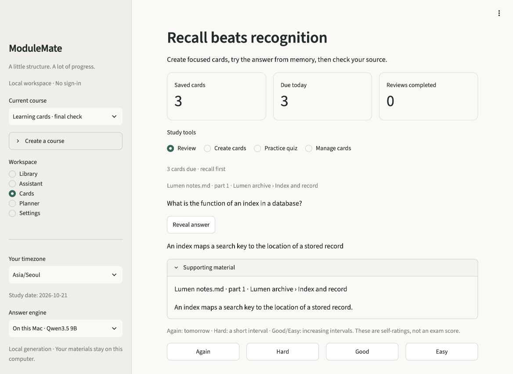

# ModuleMate 2.5 learning cards validation

Validated locally on 21 October 2026. The new **Generate from materials** path is
available beside **Write your own**. Generated cards remain editable drafts with
inspectable source excerpts. The tested implementation has no known blocking
defects; these checks do not establish universal card accuracy or learning benefit.

## Implementation identity

Development base: `a3ea4a8`. Runtime: Python 3.12.13 on an Apple Silicon Mac,
using the prepared local Qwen3.5 9B model, semantic encoder and extractive reader.
No hosted inference, Kaggle job or fine-tuning was used. The existing supervised
evidence artifacts and frozen partitions are unchanged.

The final three real-model reports share this module fingerprint:

```text
330de0fec5ba71c22ca2f44441d06f344f768d1f0f0176764e49c92bf38118de
```

It hashes the sorted `modulemate/*.py` filenames and file bytes, as implemented in
`scripts/evaluate_cards.py`. It excludes the app, fixtures and model weights.
The tested `app.py` SHA-256 is:

```text
267fea7ca91ee44cc08e9afb418bdb7950bd9fd23fd8c05b4e8b454f8c02291c
```

Fixture hashes and actual outputs are in
[the observation record](../evaluation/observations/cards-v25.json).
Records are labelled `final`, `superseded` or `partial_superseded`; an older filename
containing "final" or "release" does not make it the current validation.

## Automated and storage checks

The complete suite with local weights, native OCR and OCR stress enabled passed:
**406 tests**, with one upstream Torch deprecation warning. This includes the
real-weight checks and 65-page OCR stress test. Seven Streamlit AppTests cover the
local study journey, source focus, generated preview/edit/save/reveal, preview
invalidation, independent editor values and repeated filenames.

Ruff lint and formatting checks passed. The dependency audit passed after updating
`certifi` to 2026.10.19 for
[GHSA-6q48-6c7w-9gw2](https://github.com/certifi/python-certifi/security/advisories/GHSA-6q48-6c7w-9gw2)
and Pillow to 13.0.0 for eight advisories returned by the final audit. See the
[Pillow 13 security fixes and removals](https://pillow.readthedocs.io/en/stable/releasenotes/13.0.0.html).
Streamlit's current metadata still caps Pillow below 13, so `pyproject.toml`
declares an explicit [uv dependency override](https://docs.astral.sh/uv/concepts/resolution/#dependency-overrides).
The affected image APIs were inspected and the full suite, including image/OCR
and real-weight checks, was repeated after the upgrade. Use the documented uv setup;
a plain pip resolver still encounters Streamlit's upstream upper-bound conflict.
The release-tree check covers tracked files for private runtime artifacts and
obvious credentials; it is not a Git-history scan.

Schema-3-to-4 migration was also exercised against the existing local workspace.
A private online backup was created before migration. Every original column and
row of courses, documents, passages, chats, cards, reviews, tasks and embeddings
was preserved; SQLite integrity and foreign-key checks passed. No learner text,
row counts or private hashes are included in the public observation record.

Storage regressions cover atomic selected-deck saving, stale/deleted evidence,
cross-course evidence rejection, duplicate-save idempotence, export, source retention
after edits, and removal of derived cards when a secondary supporting document is
deleted. Existing card IDs, schedules and review histories survive migration.

## Final real-model output

The final matrix contains **22 case/style runs and 88 retained cards**: 14 mixed
cases, four explicit question-and-answer cases and four explicit cloze cases.
All completed without evaluator errors. Every retained answer and supporting quote
passed exact membership checks, and every retained card was saved into isolated
temporary storage. Empty output is valid for unsupported metadata-only material.
These text-only matrix runs preceded the Pillow upgrade. The module/app bytes
did not change; the full suite and a browser generation/save smoke check were
repeated in the final Pillow-13 environment.

| Original fictional case | Mixed recall | Question and answer | Fill in the blank |
|---|---:|---:|---:|
| Indexes, records and collisions | 6 | — | 5 |
| Calibration conditions and sample volumes | 5 | 5 | 4 |
| Queue operations, code and sentinel | 4 | 4 | 4 |
| Conflicting named trials | 4 | — | — |
| Short `pH = 8` source | 1 | 1 | 1 |
| Useful weaving notes with boilerplate | 4 | — | — |
| Useful facts beside model-directed instructions | 3 | — | — |
| Possibility, missing information and thresholds | 5 | — | — |
| Literary signals and interpretive limits | 4 | — | — |
| Formula and two-column status table | 6 | 6 | — |
| Focused collision topic | 3 | — | — |
| Sparse metadata only | 0 | — | — |
| Strict and inclusive operators | 3 | — | — |
| Long repeated source with distinct final section | 10 | — | — |

All 88 retained question/answer pairs were read against their excerpts. The final
outputs preserve strict versus inclusive thresholds, units, optional versus
prohibited behavior, named-trial attribution and the distinction between an
observation and an inference. The phrase flag `nobody designed` occurs inside a
correct negation explaining what an omission does **not** establish; it is not an
accuracy failure. Missing concept substrings are coverage hints, not automatic
semantic failures or a completeness score.

The long case read 36 of 72 passages, included the final section, and retained ten
distinct cards from a target of twelve. One strong reader disagreement caused a
same-passage answer re-binding: a question asking what an audit records now answers
"the observed result", rather than the separate fact that an audit does not
guarantee an untested entry. Two duplicates were omitted. This case is a selection
and repetition stress test, not a representative long-document benchmark.

Observed total inference times were 265.49 seconds for mixed cases, 64.21 seconds
for the explicit QA cases and 58.32 seconds for cloze cases. They are single-run
observations, exclude some setup/loading and are not latency guarantees.

Earlier failures, alternative designs, selective repairs and discarded experiments
are described in [the development record](CARDS_DEVELOPMENT.md). The archive
retains 25 generation checkpoints, including incomplete superseded runs, and the
earlier 48-card extractive-reader diagnostic. No result was re-labelled with a
newer code fingerprint.

## Browser acceptance

The current app was exercised with an isolated local database containing only
the original fictional test material. The learner's library was not used for
generation or populated with test cards.

1. Requested five QA cards from the Mora instrument notes using the prepared local
   model; inspected all five questions, answers and source locations.
2. Edited one question, excluded one draft, expanded its exact supporting excerpt,
   and saved exactly four cards. The retained edit was labelled as user-edited.
3. Confirmed review initially hid both answer and excerpt. Revealed the answer and
   source, graded Good, and verified the next card was hidden, the due count fell
   from four to three and the review count became one.
4. Saved a manual card through **Write your own**, bringing the isolated course to
   five cards. Started a practice quiz, entered a recall attempt and revealed its
   answer/source controls without changing its review schedule.
5. After the Pillow-13 update and full-suite rerun, generated and saved three new
   cards from the fictional Lumen archive notes in a separate isolated course.
   Rechecked the hidden-answer/reveal/source workflow in the final environment.

Actual browser captures from that final compatibility check:




## Reproduce

Prepare the pinned public models using the README setup first. These commands
use original test fixtures and temporary storage, not the learner's workspace.

```sh
uv sync --locked --extra ml --extra local
uv run --locked --extra ml --extra local ruff check .
uv run --locked --extra ml --extra local ruff format --check .
MODULEMATE_TEST_LOCAL_ML=1 MODULEMATE_TEST_OCR=1 MODULEMATE_TEST_OCR_STRESS=1 \
  uv run --locked --extra ml --extra local pytest -q
uv run --locked --extra ml --extra local pip-audit
uv run --locked --extra ml --extra local python scripts/check_release.py

uv run --locked --extra ml --extra local python scripts/evaluate_cards.py \
  --fixture evaluation/card_materials.json evaluation/card_transfer.json evaluation/card_long.json \
  --semantic --output results/cards-mixed.json
uv run --locked --extra ml --extra local python scripts/evaluate_cards.py \
  --fixture evaluation/card_materials.json evaluation/card_transfer.json \
  --cases conditions code short formula-and-table --style 'Question and answer' \
  --semantic --output results/cards-qa.json
uv run --locked --extra ml --extra local python scripts/evaluate_cards.py \
  --cases concepts conditions code short --style 'Fill in the blank' \
  --semantic --output results/cards-cloze.json
```

## Practical limits

These authored cases informed implementation and are not a blind test set.
Quotation membership cannot prove the premise of an AI-written question; the
model critic and reader can also make mistakes. The reader's margin threshold is
a repair heuristic, not a truth probability. Literal answers can be longer than a
human-written paraphrase, and bounded context samples large material selections.
Recognized two-column Markdown tables have a dedicated path; arbitrary diagrams
and table layouts still depend on extracted text quality. Source excerpts cannot
correct an OCR error in the original import. Review, editing and discard remain
part of the normal creation workflow.
