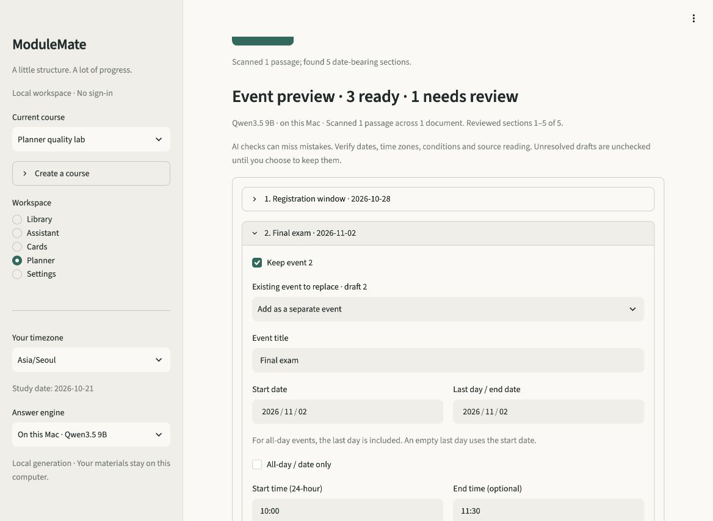
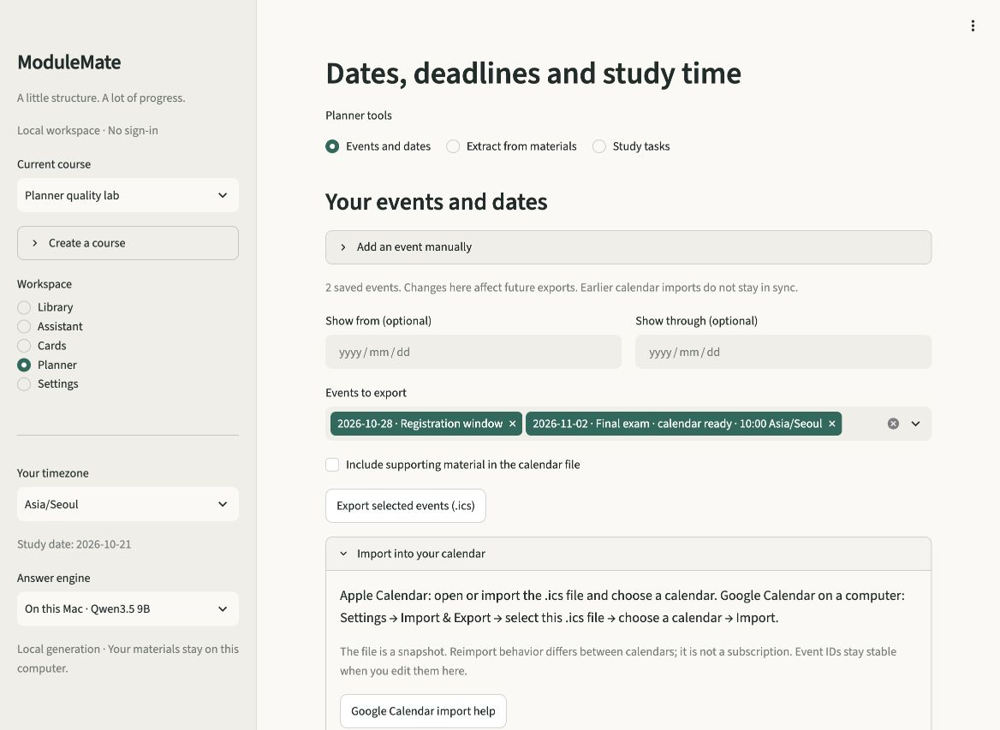

# ModuleMate 2.6 material-based Planner validation

Validated locally on 21 October 2026, from development base `56784df`. The Planner
now provides selected-material extraction, editable/selectable drafts, durable
events, explicit replacement, manual creation and portable calendar export.
Existing capacity planning remains available as **Study tasks**.

The tested implementation has no known blocking defects. These authored checks
do not establish universally perfect extraction or zero false positives on
arbitrary material. Uncertain drafts remain unchecked for human correction.

## Implementation and actual-output identity

Runtime: Python 3.12.13, Streamlit 1.65.0 and icalendar 7.3.0 on Apple Silicon,
using the prepared local Qwen3.5 9B generator. No hosted inference, Kaggle job,
fine-tuning or learner-library evaluation was used.

Final module fingerprint:

```text
ea4f088582478a0113b74f9a51ad272b1f87a3a7d8b93e2c8e2978ec08a6b8f6
```

It hashes sorted `modulemate/*.py` names and bytes, as implemented in
`scripts/evaluate_planner.py`. It excludes app, fixtures, dependencies and weights.
Tested `app.py` SHA-256:

```text
aa6a5138d4c12083fc8e0413cc7dae5f1ad1ced29566a311e33defef34c16559
```

Fixture hashes and every actual model call/event are retained in
[the observation record](../evaluation/observations/planner-v26.json).
Eleven reports are explicitly labelled final or superseded. Earlier failures and
the free-JSON alternative remain inspectable; fingerprints were not rewritten.
See [the development decisions](PLANNER_DEVELOPMENT.md).

## Final real-model matrix

The final run covers **32 cases**, **53 ready events** and **17 held drafts**.
Every specified resolved event matched the expected title/date/time/location/
recurrence fields supplied for that case. There were no extra or mismatched
ready events, missing expected events, unmet minimum uncertainty counts or
evaluation errors. All ready events passed exact source membership, saved into
isolated temporary databases and round-tripped through iCalendar. Output lines
passed UTF-8 folding checks.

| Original fictional case | Ready | Held |
|---|---:|---:|
| Course registration, class, report and exam duration | 4 | 0 |
| History, examples and publication metadata | 0 | 0 |
| Rescheduled exam and cancelled seminar | 2 | 0 |
| Numeric order, missing year and weekday conflict | 0 | 3 |
| Weekly studio sessions with an exception | 1 | 0 |
| Tentative meeting | 0 | 1 |
| Assessment table with distinct row times | 2 | 0 |
| Unanchored relative deadlines | 0 | 2 |
| Explicit zone, ambiguous zone and DST gap | 1 | 2 |
| Real schedule beside model-directed source instructions | 1 | 0 |
| Missing years supported by a same-document term heading | 2 | 0 |
| Multiday event across the year boundary | 1 | 0 |
| ISO UTC, fixed offset and DST fold | 2 | 1 |
| Explicit day/month convention | 1 | 0 |
| Independent date list and inherited PM | 2 | 0 |
| Unsupported daily recurrence | 0 | 1 |
| Date bound without a confirmed date | 0 | 1 |
| Inclusive submission window | 1 | 0 |
| Historical meeting narrative | 0 | 0 |
| Mock calendar under a sample-data heading | 0 | 0 |
| Conflicting notices in separate documents | 0 | 2 |
| Missing AM/PM and ambiguous midnight boundary | 0 | 2 |
| Unique final event after 80 unrelated passages | 1 | 0 |
| Exam time beside an unrelated library opening time | 1 | 0 |
| Two submission deadlines in one paragraph | 2 | 0 |
| Cancellation beside a different scheduled workshop | 1 | 0 |
| Conditional proposal without confirmation | 0 | 1 |
| Date-shaped software/sample identifiers | 0 | 0 |
| Evening weekly office hours with an exception | 1 | 0 |
| Two-digit year without a century | 0 | 1 |
| Explicitly archived course schedule | 1 | 0 |
| Dense calendar table spanning overlapping imported passages | 26 | 0 |

Actual event fields, descriptions and supporting excerpts were inspected, not just
the diagnostic totals. The final run's non-table outputs match the earlier
inspected acceptance run. The two short table events now retain individual row
descriptions/excerpts; all 26 dense-table events were inspected separately.
The run took 404.94 seconds of recorded case execution, excluding some setup.
This is a single local observation, not a latency guarantee.

The dense table took 73.62 seconds with explicit column reading and five AI review
calls, versus 196.13 seconds for the prior row-writer approach that recovered only
24 events. The final approach recovered all 26, saved/exported them successfully,
and omitted the redundant writer calls. A sample-calendar regression verifies
that structured rows still need AI relevance/source approval. The initial attempt
before row separation failed with no approved drafts; that failure is retained.

## Automated, calendar and storage checks

The expanded locked-environment suite passed **480 tests**, with one upstream
Torch deprecation warning, in 27.65 seconds. It includes existing conversation,
Cards, real local-weight and 65-page OCR stress checks.

Planner-specific regressions cover:

- Native TXT, Markdown, PDF, Word tables, PowerPoint and notebook extraction,
  plus real local OCR of printed PNG, JPEG and scanned PDF dates/clocks.
- Invalid, missing and ambiguous dates; numeric conventions; year headings scoped
  to their own document; lists/ranges; clocks, durations, offsets and overnight
  events; strict source IDs and malformed model rows.
- Cancellation/history/example/source-instruction boundaries; critic outages,
  incomplete reviews, conflicting documents and per-event source binding.
- Continuation beyond 180 date-bearing sections, preserved preview edits and
  source-setting invalidation; individual review of expanded date lists.
- Dense table rows, cut/duplicated ingestion overlap, explicit column binding
  followed by AI relevance review, and sample calendars that must stay excluded.
- DST gaps/folds, every weekly occurrence, deliberately excluded gap times and
  a final bound on a whole-day timezone transition.
- Calendar point events without invented end times, inclusive all-day ranges,
  escaping/injection resistance, UTF-8 folding, UTC identity and encoded links.
- Independent `dateutil` recurrence expansion: nine occurrences keep 10:00 local
  across the New York DST transition, omit the exception and retain the final day.
- Atomic saves, stale/cross-course evidence rejection, duplicate extraction,
  edited-source retention, supporting-document deletion and workspace export.
- Stable UID and incremented SEQUENCE after edits/replacements; deliberate
  replacement, unauthorized targets and duplicate replacement rollback.
- Actual Streamlit preview/edit/select/save/remove/export, unknown-date correction,
  missing-clock/zone correction, revised-notice replacement, continuation and
  refreshed export labels that preserve an excluded selection after saved edits.

Ruff lint/format, dependency audit and release-tree checks passed. The existing
Pillow override remains documented in [2.5 compatibility validation](VALIDATION_V25.md).
The release-tree check scans tracked current files; it is not a Git-history scan.

The original schema-4 workspace was stopped, backed up privately and migrated
to schema 5. Every original column/row hash matched before and after; the task-start
snapshot also matched. Database and backup permissions were private (0600).
SQLite integrity and foreign-key checks passed. No learner content, private hashes
or row counts are published. The main app was restarted against the current build.

## Browser acceptance

Browser checks use an isolated database containing only original fictional
material, with a second unselected course. Test events are never added to the
learner's library.

1. Selected the course schedule and generated three ready events plus one
   unresolved date/time/zone mention using the actual local generator.
2. Inspected the registration range, exam's literal 90-minute duration, report's
   point-in-time deadline and exact supporting material. Historical prose produced
   no event. The ambiguous meeting stayed unchecked with its date/time/zone issues.
3. Edited the registration and exam titles, excluded the report and unresolved
   meeting, and saved exactly two events.
4. Downloaded the real browser .ics file. Parsed exactly those two edited events,
   matched their UIDs to saved IDs, verified October 28–30 exports with exclusive
   October 31 DTEND, and verified the exam exports as 01:00–02:30 UTC (10:00–11:30
   Seoul). Supporting excerpts were off by default.
5. Inspected the generated Google template URL without creating an external event.
   Edited the saved exam twice and downloaded only that selected event. Its
   refreshed title and selection were correct; UID stayed stable and SEQUENCE
   incremented twice. Dates/times stayed unchanged.
6. Removed the disposable registration event in the isolated app, leaving the
   edited exam. The learner's database was not populated with test events.
7. Repeated actual generation on the final build, inspected the same three ready
   events and unchecked ambiguous mention, excluded the report again and saved.
   Only the removed registration event was added; re-extraction preserved the
   saved exam's edited title and revision. Downloaded and parsed the final
   two-event selection again. The preview/export screenshots below are from this
   final-build check.

The initial download SHA-256 was
`abb791f306bcf92bf44c41a3880aa659837cffc9111b9ca5476e67cfaa287e75`.
This identifies that actual downloaded test artifact; it is not a deterministic
reference file because saved IDs and timestamps vary.





## Reproduce

Prepare the pinned models with the README setup first.

```sh
uv sync --locked --extra ml --extra local
uv run --locked --extra ml --extra local ruff check .
uv run --locked --extra ml --extra local ruff format --check .
MODULEMATE_TEST_LOCAL_ML=1 MODULEMATE_TEST_OCR=1 MODULEMATE_TEST_OCR_STRESS=1 \
  uv run --locked --extra ml --extra local pytest -q
uv run --locked --extra ml --extra local pip-audit
uv run --locked --extra ml --extra local python scripts/check_release.py
uv run --locked --extra ml --extra local python scripts/evaluate_planner.py \
  --fixture evaluation/planner_dense.json evaluation/planner_materials.json evaluation/planner_transfer.json evaluation/planner_acceptance.json \
  --output results/planner.json
uv run --locked --extra ml --extra local python scripts/evaluate_planner.py \
  --approach free_json --output results/planner-baseline.json
```

## Practical limits

The cases informed development; they are neither blind nor representative.
Literal membership proves provenance, not that the chosen time belongs to the
right event. The semantic selector and reviewer can both be wrong. OCR may misread
the original; unread source locations retain import notices. Extraction targets
English text/date expressions and cannot guarantee arbitrary diagram/table reading.

Unanchored relative dates, unsupported recurrence, missing/ambiguous facts and
conflicting notices require correction. Weekly recurrence must be bounded within
two years; other recurrence patterns are held for manual review. Large selections
review 180 date-bearing sections per request and can continue through later
sections after save/discard. Coverage reflects the extracted passages available,
not a claim that all original pages were read successfully.

Explicit calendar tables use their labelled columns; unknown layouts retain the
AI identification path. Very dense prose is flagged when a single section
exceeds the writer's 18-row response capacity. Split such content into shorter
notes and inspect coverage. The separate no-generator scan lists unreviewed date
mentions for manual completion; it does not promise semantic event extraction.

An .ics export is a calendar snapshot, not synchronization. Stable IDs do not
guarantee that every client deduplicates a repeated manual import. No external
calendar account was modified or live client import claimed. Standards-based
serialization, parser checks and independent recurrence expansion were verified;
the actual calendar client controls its import dialog and display.
