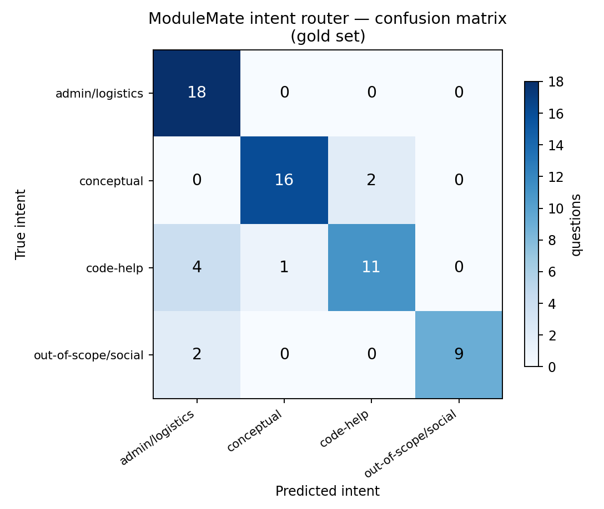

# ModuleMate — Evaluation Results

Gold set: **63 questions** (52 in-scope, 11 out-of-scope). Evaluation wall-clock 1028.0 s.

Index: **1799 chunks** from 51 documents, built 2026-07-29 10:20:11. Embeddings `sentence-transformers/all-MiniLM-L6-v2`; generation `llama-3.3-70b-versatile` via `openai_compatible`; k=5, refusal threshold 0.48.

## NFR scorecard

| ID | Aspect | Target | Measured | Verdict | Notes |
|---|---|---|---|---|---|
| NFR1 | Latency — interactive (median) | < 5 s | **3.12 s** | PASS | Questions spaced by a reading pause, as a student would ask them. See `latency_interactive.md`. This is the condition NFR1 describes. |
| NFR1 | Latency — sustained burst (median) | < 5 s (informational) | **10.82 s** | **FAIL** | p90 16.23 s, max 24.15 s, measured while the harness issues 49 questions plus judge calls with no pause. The gap against the interactive figure is hosted-API throttling under load (risk R3), not model or pipeline speed — local embedding and exact-index retrieval account for under 30 ms of it. A paid tier or local open-weights generation removes the ceiling. |
| NFR2 | Retrieval hit@3 | >= 0.85 | **0.923 [0.82–0.97]** | PASS | Share of in-scope gold questions whose expected chunk appears in the top 3 retrieved passages. |
| NFR2 | Retrieval hit@3 — document level | informational | **1.000** | — | Same questions, scored on whether the expected document appears in the top 3 at all. The gap against exact hit@3 is locator-level misses and questions the corpus answers correctly in more than one place — see `retrieval_analysis.md`. |
| NFR2 | Citation correctness (exact doc + slide/section) | >= 0.90 | **0.940 [0.84–0.98]** | PASS | Document-level correctness alone is 0.980; the gap is answers citing an adjacent slide within the correct deck. |
| NFR3 | Refusal rate on out-of-scope set | >= 0.95 | **1.000 [0.74–1.00]** | PASS | Refusals by cause — intent router 8, similarity gate 2, generator self-report 3. |
| NFR3 | Fabricated citations | 0 | **0** | PASS | A citation counts as fabricated if its (document, slide/section) pair does not exist anywhere in the index — checked against the whole index, not just the retrieved passages. |
| O1 | Groundedness (LLM judge, RAGAS-style) | >= 0.90 | **0.960 [0.87–0.99]** | PASS | Share of answers whose every factual claim is supported by the retrieved passages. |
| O4 | Intent-router accuracy | >= 0.85 | **0.857 [0.75–0.92]** | PASS | Measured on the gold set, which is disjoint from the router's hand-authored training utterances. |
| — | False-refusal rate on in-scope questions | low (no target) | **0.038** | — | Reported because refusal rate alone can be trivially maximised by refusing everything; this is the counterweight. |
| — | Key fact present in answer | >= 0.90 | **0.960** | PASS | Exact-match check that the expected figure or name (e.g. "4000", "YANG") actually appears in the answer text. |
| NFR4 | Privacy — corpus embedded locally, top-k only to API | by design | **satisfied** | PASS | Embeddings run locally via sentence-transformers; only the k retrieved passages and the question reach the generation API. No student PII is collected or stored. |
| NFR5 | Maintainability — k, threshold and models in config | by design | **satisfied** | PASS | All three read from config.yaml through config.py; corpus refresh is drop-a-file plus one command (FR9). |
| NFR6 | Usability — cited answer without instruction | by design | **satisfied (unmeasured)** | — | No user study was run; this is a design claim, not a measurement. The UI renders citations inline and exposes source passages with similarity scores in one click. |
| NFR7 | Reproducibility — pinned deps, fixed seed | by design | **satisfied** | PASS | requirements.txt is fully pinned; classifier seed fixed in config.yaml; generation temperature 0. |

**14/15 criteria met.** 1 missed — see notes above.

## Retrieval and generation detail

| Metric | Value |
|---|---|
| `hit_at_3` | 0.9231 |
| `hit_at_3_document` | 1.0 |
| `hit_at_retrieval_k` | 0.9423 |
| `citation_correctness` | 0.94 |
| `citation_document_correctness` | 0.98 |
| `groundedness` | 0.96 |
| `key_fact_present` | 0.96 |
| `fabricated_citation_count` | 0 |
| `refusal_rate_out_of_scope` | 1.0 |
| `false_refusal_rate_in_scope` | 0.0385 |
| `intent_accuracy` | 0.8571 |
| `latency_median` | 10.825 |
| `latency_mean` | 9.075 |
| `latency_p90` | 16.231 |
| `latency_max` | 24.15 |
| `n_answered` | 50 |

## Generation models actually used (R3 fallback)

The primary model exhausted its daily token allowance during this run and the fallback chain took over automatically, mid-evaluation, with no configuration change and no failed turn.

| Model | Turns served |
|---|---|
| `llama-3.1-8b-instant` | 36 |
| `openai/gpt-oss-120b` | 17 |

## Retrieval ablation (C1, C2)

| Configuration | exact hit@3 | exact hit@5 | document hit@3 | MRR@5 |
|---|---|---|---|---|
| dense only (baseline) | 0.788 | 0.827 | 0.904 | 0.667 |
| dense + authority prior | 0.846 | 0.865 | 0.962 | 0.739 |
| dense + authority + BM25 (C1) | 0.750 | 0.865 | 0.942 | 0.719 |
| dense + authority + cross-encoder (C2) | 0.923 | 0.942 | 1.000 | 0.864 |
| all stages (C1 + C2) | 0.923 | 0.942 | 1.000 | 0.864 |

**exact hit@k** requires the precise (document, slide/page) pair named in the gold set. **document hit@3** requires only the right document, and is the fairer measure where the corpus answers a question correctly in more than one place. **MRR@5** is the mean reciprocal rank of the expected passage within the top 5, so it rewards moving the right passage up even when it was already retrieved.

Full sweep: [`ablation.md`](ablation.md)

## Refusals by cause

| Cause | Count | Meaning |
|---|---|---|
| `intent` | 8 | Router classified the turn `out-of-scope/social`; no retrieval, no API call. |
| `threshold` | 2 | Best retrieved passage scored below the calibrated similarity threshold. |
| `model` | 3 | Generator returned `INSUFFICIENT_CONTEXT` despite passing the gate. |

## Per-intent breakdown

| Intent | n | hit@3 | citation ok | grounded | refused |
|---|---|---|---|---|---|
| `admin/logistics` | 18 | 0.778 | 0.875 | 0.875 | 2/18 |
| `conceptual` | 18 | 1.000 | 0.944 | 1.000 | 0/18 |
| `code-help` | 16 | 1.000 | 1.000 | 1.000 | 0/16 |
| `out-of-scope/social` | 11 | — | — | — | 11/11 |

## Intent-router confusion matrix (S3)

Rows are the true intent, columns the predicted intent.

| true \ pred | pred `admin/logistics` | pred `conceptual` | pred `code-help` | pred `out-of-scope/social` | total |
|---|---|---|---|---|---|
| **`admin/logistics`** | 18 | 0 | 0 | 0 | 18 |
| **`conceptual`** | 0 | 16 | 2 | 0 | 18 |
| **`code-help`** | 4 | 1 | 11 | 0 | 16 |
| **`out-of-scope/social`** | 2 | 0 | 0 | 9 | 11 |

## Retrieval misses (expected chunk outside top-3)

| ID | Question | Expected | Top score |
|---|---|---|---|
| `adm01` | What is the word limit for the individual project report? | Lectures Week 2__HIT summer course_AI and ML_project_July2026 | Requirements | 0.5521 |
| `adm10` | Am I allowed to use AI tools when working on this project? | Lectures Week 2__HIT summer course_AI and ML_project_July2026 | Penalty | 0.5163 |
| `adm15` | What language proficiency is required for the summer school? | 2026 HIT Global Summer School Academic theme list | page 1 | 0.4388 |
| `adm18` | When is the individual assignment due, as opposed to the project? | Lectures Week 2__HIT summer course_AI and ML_assignment_July2026 | The submission | 0.5826 |

## Intent misclassifications

| ID | Question | True | Predicted | Confidence |
|---|---|---|---|---|
| `con07` | What is k-means clustering? | `conceptual` | `code-help` | 0.445 |
| `con09` | What is the k-nearest neighbours algorithm? | `conceptual` | `code-help` | 0.911 |
| `cod11` | What is top-down decision tree induction? | `code-help` | `conceptual` | 0.541 |
| `cod12` | How many pull requests should be retrieved for each project in the code review experiment? | `code-help` | `admin/logistics` | 0.801 |
| `cod13` | Which API is used to retrieve pull request data in the code review lab? | `code-help` | `admin/logistics` | 0.502 |
| `cod14` | What approaches increase the importance of the minor class in imbalanced classification? | `code-help` | `admin/logistics` | 0.271 |
| `cod15` | Which Python libraries does the product sentiment notebook use? | `code-help` | `admin/logistics` | 0.365 |
| `oos08` | Can you grant me an extension on my submission deadline? | `out-of-scope/social` | `admin/logistics` | 0.601 |
| `oos11` | Can you write my project report for me? | `out-of-scope/social` | `admin/logistics` | 0.586 |

## Per-question results

| ID | Intent | Refused | hit@3 | Citation ok | Grounded | Latency (s) |
|---|---|---|---|---|---|---|
| `adm01` | `admin/logistics` | no | no | yes | yes | 11.577 |
| `adm02` | `admin/logistics` | no | yes | yes | yes | 3.771 |
| `adm03` | `admin/logistics` | no | yes | yes | yes | 2.851 |
| `adm04` | `admin/logistics` | no | yes | yes | yes | 1.829 |
| `adm05` | `admin/logistics` | no | yes | yes | yes | 1.845 |
| `adm06` | `admin/logistics` | no | yes | yes | yes | 1.691 |
| `adm07` | `admin/logistics` | no | yes | yes | yes | 10.386 |
| `adm08` | `admin/logistics` | no | yes | no | yes | 9.212 |
| `adm09` | `admin/logistics` | no | yes | yes | no | 9.885 |
| `adm10` | `admin/logistics` | yes | no | — | — | 11.347 |
| `adm11` | `admin/logistics` | no | yes | yes | yes | 10.071 |
| `adm12` | `admin/logistics` | no | yes | yes | yes | 9.998 |
| `adm13` | `admin/logistics` | no | yes | yes | yes | 17.819 |
| `con01` | `conceptual` | no | yes | yes | yes | 13.727 |
| `con02` | `conceptual` | no | yes | yes | yes | 17.221 |
| `con03` | `conceptual` | no | yes | yes | yes | 15.069 |
| `con04` | `conceptual` | no | yes | yes | yes | 13.811 |
| `con05` | `conceptual` | no | yes | yes | yes | 1.436 |
| `con06` | `conceptual` | no | yes | yes | yes | 18.021 |
| `con07` | `conceptual` | no | yes | yes | yes | 17.837 |
| `con08` | `conceptual` | no | yes | yes | yes | 19.026 |
| `con09` | `conceptual` | no | yes | yes | yes | 16.231 |
| `con10` | `conceptual` | no | yes | yes | yes | 16.132 |
| `con11` | `conceptual` | no | yes | no | yes | 15.229 |
| `con12` | `conceptual` | no | yes | yes | yes | 5.099 |
| `con13` | `conceptual` | no | yes | yes | yes | 14.997 |
| `con14` | `conceptual` | no | yes | yes | yes | 1.61 |
| `cod01` | `code-help` | no | yes | yes | yes | 12.494 |
| `cod02` | `code-help` | no | yes | yes | yes | 11.002 |
| `cod03` | `code-help` | no | yes | yes | yes | 1.914 |
| `cod04` | `code-help` | no | yes | yes | yes | 5.64 |
| `cod05` | `code-help` | no | yes | yes | yes | 14.378 |
| `cod06` | `code-help` | no | yes | yes | yes | 13.036 |
| `cod07` | `code-help` | no | yes | yes | yes | 13.073 |
| `cod08` | `code-help` | no | yes | yes | yes | 15.099 |
| `cod09` | `code-help` | no | yes | yes | yes | 14.198 |
| `cod10` | `code-help` | no | yes | yes | yes | 17.331 |
| `cod11` | `code-help` | no | yes | yes | yes | 15.008 |
| `con15` | `conceptual` | no | yes | yes | yes | 12.063 |
| `con16` | `conceptual` | no | yes | yes | yes | 10.019 |
| `con17` | `conceptual` | no | yes | yes | yes | 14.222 |
| `con18` | `conceptual` | no | yes | yes | yes | 10.825 |
| `cod12` | `code-help` | no | yes | yes | yes | 1.509 |
| `cod13` | `code-help` | no | yes | yes | yes | 16.079 |
| `cod14` | `code-help` | no | yes | yes | yes | 12.901 |
| `cod15` | `code-help` | no | yes | yes | yes | 10.834 |
| `adm14` | `admin/logistics` | no | yes | yes | yes | 24.15 |
| `adm15` | `admin/logistics` | yes | no | — | — | 0.531 |
| `adm16` | `admin/logistics` | no | yes | yes | yes | 11.142 |
| `adm17` | `admin/logistics` | no | yes | yes | yes | 9.665 |
| `adm18` | `admin/logistics` | no | no | no | no | 1.535 |
| `cod16` | `code-help` | no | yes | yes | yes | 1.481 |
| `oos01` | `out-of-scope/social` | yes | — | — | — | 0.023 |
| `oos02` | `out-of-scope/social` | yes | — | — | — | 0.012 |
| `oos03` | `out-of-scope/social` | yes | — | — | — | 0.008 |
| `oos04` | `out-of-scope/social` | yes | — | — | — | 0.013 |
| `oos05` | `out-of-scope/social` | yes | — | — | — | 0.011 |
| `oos06` | `out-of-scope/social` | yes | — | — | — | 0.014 |
| `oos07` | `out-of-scope/social` | yes | — | — | — | 0.414 |
| `oos08` | `out-of-scope/social` | yes | — | — | — | 2.488 |
| `oos09` | `out-of-scope/social` | yes | — | — | — | 0.023 |
| `oos10` | `out-of-scope/social` | yes | — | — | — | 0.008 |
| `oos11` | `out-of-scope/social` | yes | — | — | — | 10.856 |
